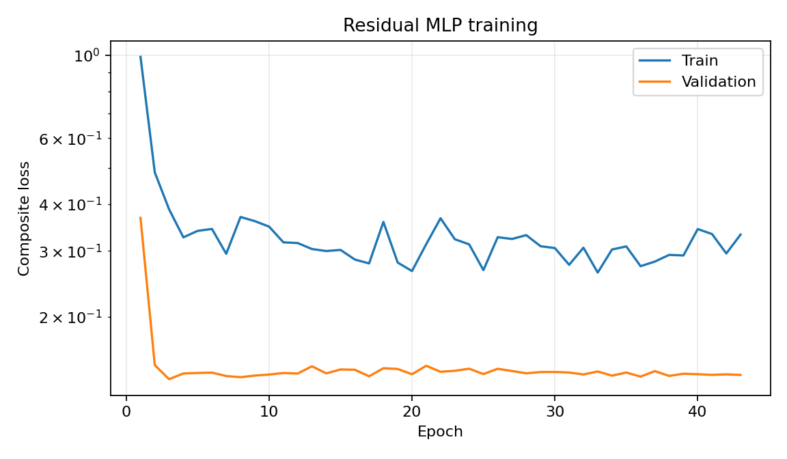
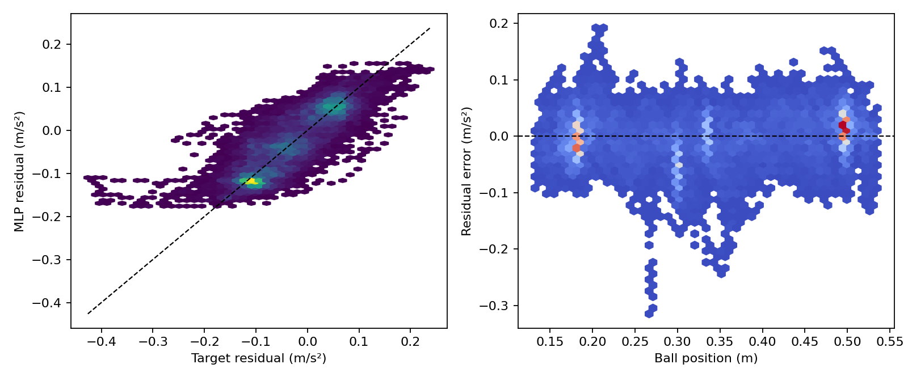
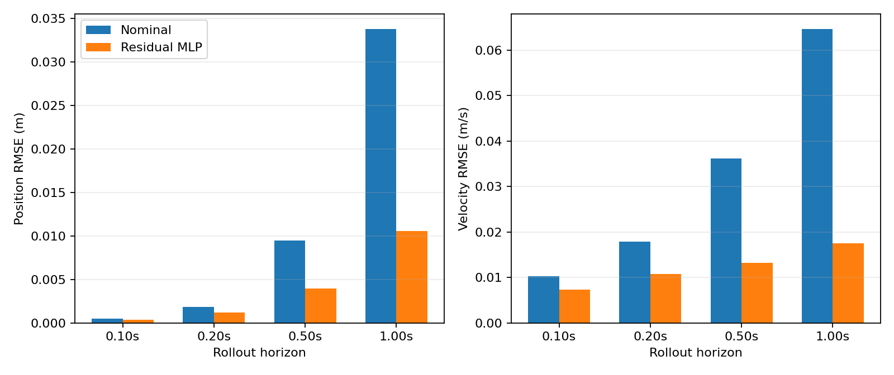
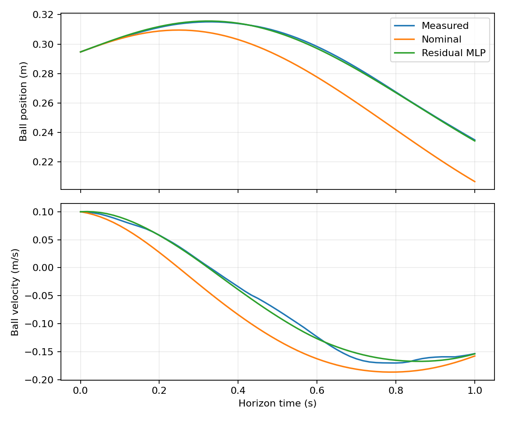

# Five-input MLP Ball-Acceleration Residual Identification

## 1. Objective and boundary

The real ball acceleration is represented as

$$
a_b=a_{\mathrm{nom}}+r_a,
\qquad
r_a=f_\phi(p_b,v_b,\theta,\omega,a_{\mathrm{nom}}).
$$

This experiment identifies only the smooth, bounded residual term. It does not
fit a separate local-slope model, a mixture of experts, a recurrent model, or a
discrete collision law. It also does not integrate the learned residual into
the C++ state predictor or acados NMPC.

## 2. Source data and split

The source is the real-world unified-tracking dataset collected on 2026-08-15.
The logger stores one latched ball observation per approximately 60 Hz control
callback even though the Laser hardware is nominally faster. Consequently, the
dataset must be interpreted as an approximately 60 Hz sequence rather than a
240 Hz raw measurement stream.

Only trials with `phase=tracking` and `end_reason=tracking_duration` are
included. The stale-beam termination is excluded. The fixed split is:

- Training: standard `trial_001` and `trial_002` plus both completed
  `constant_035_2` trials, for 20 trials total.
- Validation/final offline evaluation: standard `trial_003`, for 9 trials
  total.

There is no independent test set. Since validation controls early stopping and
also supplies the final reported metrics, those metrics are development
estimates and are not an unbiased estimate for an unseen installation or new
experiment session. Adding `constant_035_2` to training increases session and
central-position coverage but removes the ability to assess that session as an
independent domain shift.

The processed-data manifest records source-relative paths and SHA-256 hashes.
Training never reads the raw CSV files after preprocessing.

## 3. Time processing and state estimation

Processing uses `t_trial` and the measured interval. A gap larger than 2.5
times the segment median interval starts a new segment. Each segment is
resampled to its median interval and filtered independently.

- Ball position: 31-sample, third-order Savitzky-Golay filter. Its zeroth,
  first, and second derivatives provide $\hat p_b,\hat v_b,\hat a_b$.
- Beam angle: 11-sample, third-order Savitzky-Golay filter.
- Drone vertical velocity: 7-sample, second-order Savitzky-Golay filter.
- The first and last 15 samples of every segment are discarded.

The online `obs_ab` field is not a target, and acceleration is never obtained
by directly applying a raw second finite difference.

## 4. Nominal model and residual target

The controller geometry is reproduced exactly:

$$
\sin\beta=\frac{L}{R}(1-\cos\theta),
\qquad
\omega=-\frac{v_{rz}\cos\beta}{L\cos(\beta-\theta)}.
$$

The nominal ball acceleration is

$$
a_{\mathrm{nom}}
=\gamma\left[(p_b+p_0-L)\omega^2-g\sin\theta\right],
$$

where all constants are read from each trial's metadata. The pointwise
auxiliary target is

$$
r_a^{\mathrm{label}}=\hat a_b-a_{\mathrm{nom}}.
$$

The five inputs are

$$
[\hat p_b,\hat v_b,\hat\theta,\omega,a_{\mathrm{nom}}].
$$

Mean and standard deviation are computed from training trials only and stored
with the model. Validation data never affects normalization.

## 5. Network

The model is a `5 -> 16 -> 16 -> 1` MLP. Both hidden layers use `tanh`; the
bounded output is

$$
r_a=0.25\tanh(y)\ \mathrm{m/s^2}.
$$

Training and export use float64. The final layer starts at zero so that the
initial model is exactly the nominal model. The exported NPZ contains the
three affine layers, normalization statistics, output limit, input ordering,
activation contract, and provenance hashes.

## 6. Multi-step training

Beam angle and angular velocity are treated as measured exogenous sequences.
Ball position and velocity are recursively integrated by differentiable RK4.
The MLP and nominal acceleration are re-evaluated at every RK4 stage.

Each window contains 30 control intervals. Position and velocity losses are
evaluated at steps 6, 12, and 30 with weights 0.2, 0.3, and 0.5. The objective
is

$$
\mathcal L=
\mathcal L_{p,\mathrm{rollout}}
+\mathcal L_{v,\mathrm{rollout}}
+0.25\mathcal L_{r,\mathrm{Huber}}
+10^{-4}\mathcal L_{\mathrm{Jacobian}}.
$$

Position error is normalized by 0.01 m and velocity error by 0.05 m/s. The
Huber transition is 0.02 m/s². Trial selection is uniform, followed by balanced
sampling of negative, near-zero, and positive velocity regimes. These regimes
affect sampling only; there remains exactly one network.

The fixed seed is 7. AdamW uses learning rate 0.001 and weight decay 1e-5,
batch size 128, 32 steps per epoch, at most 500 epochs, plateau learning-rate
decay, and early-stopping patience 40.

## 7. Runtime device and W&B

When CUDA is available, CPU and GPU execute the same complete training step,
including the 30-step RK4 rollout, loss, backward pass, and optimizer update.
CUDA is selected only if its median step time is at least 20% lower. Device
benchmark state is discarded before formal training. Final evaluation is
recomputed on CPU in float64.

W&B records aggregate batch/epoch losses, rollout metrics, gradient norms,
parameter and gradient histograms, learning rate, timing, and device memory.
It is online-first and falls back to an offline local run. Raw CSV, processed
NPZ, checkpoints, complete predictions, credentials, and absolute paths are
never uploaded.

## 8. Validation and acceptance

Validation compares the nominal model and residual MLP using pointwise
residual error and free rollouts of approximately 0.1, 0.2, 0.5, and 1.0 s.
Metrics are also grouped by trajectory, ball position, and velocity regime.

The acceptance criteria are:

- Residual RMSE no greater than 0.050 m/s².
- At least 30% position and velocity MSE improvement at 0.5 s.
- No dynamic trajectory with more than 10% rollout RMSE degradation.
- Median predicted total acceleration below 0.020 m/s² on near-static constant
  samples.
- Residual saturation rate below 1%.
- Finite model outputs and input gradients.

Failure is reported without changing the seed, trial split, or formal zero
time shift.

## 9. Reproduction

From the repository root:

```bash
conda run -n isaac-sim python -m residual_dynamics.cli all \
  --config residual_dynamics/configs/mlp_5input.yaml
```

Tests:

```bash
conda run -n isaac-sim python -m pytest residual_dynamics/tests -q
```

<!-- BEGIN GENERATED RESULTS -->
## 实际训练与验证结果

- Run：`mlp5_seed7_8777501a_20260816_171018`
- 随机种子：`7`
- 最佳 epoch：`3`（停止原因：`early_stopping`）
- 训练设备：`cpu`
- CPU/GPU 基准：CPU 24.80 ms/step，NVIDIA GeForce RTX 4060 Ti 63.75 ms/step；CUDA did not meet the configured speedup threshold
- 总训练时间：53.1 s
- W&B 模式：`online`；Run ID：`fs2uc5xh`
- W&B 链接：[https://wandb.ai/polyu_robotics/aerial-balance-residual-dynamics/runs/fs2uc5xh](https://wandb.ai/polyu_robotics/aerial-balance-residual-dynamics/runs/fs2uc5xh)
- 总体验收：**PASS**

### 逐点加速度残差

| 模型 | RMSE (m/s²) | MAE (m/s²) | Bias (m/s²) | R² |
| --- | ---: | ---: | ---: | ---: |
| 名义模型 | 0.084226 | 0.070263 | 0.031551 | -0.1632 |
| 五输入 MLP | 0.044448 | 0.033618 | 0.003352 | 0.6760 |

### 多步自由 rollout

| Horizon | 模型 | 位置 RMSE (m) | 速度 RMSE (m/s) | 位置 MSE 改善 | 速度 MSE 改善 |
| ---: | --- | ---: | ---: | ---: | ---: |
| 0.100 s | 名义模型 | 0.000521 | 0.010246 | — | — |
| 0.100 s | 五输入 MLP | 0.000376 | 0.007314 | 47.7% | 49.1% |
| 0.200 s | 名义模型 | 0.001853 | 0.017910 | — | — |
| 0.200 s | 五输入 MLP | 0.001178 | 0.010799 | 59.5% | 63.6% |
| 0.500 s | 名义模型 | 0.009493 | 0.036221 | — | — |
| 0.500 s | 五输入 MLP | 0.003952 | 0.013263 | 82.7% | 86.6% |
| 1.000 s | 名义模型 | 0.033826 | 0.064680 | — | — |
| 1.000 s | 五输入 MLP | 0.010569 | 0.017535 | 90.2% | 92.7% |

### 分轨迹的 0.5 s rollout

| 轨迹 | 名义位置 RMSE | MLP位置 RMSE | 位置MSE改善 | 名义速度 RMSE | MLP速度 RMSE | 速度MSE改善 |
| --- | ---: | ---: | ---: | ---: | ---: | ---: |
| `constant_015` | 0.007307 | 0.002038 | 92.2% | 0.028583 | 0.006482 | 94.9% |
| `constant_035` | 0.009079 | 0.005342 | 65.4% | 0.035886 | 0.019634 | 70.1% |
| `constant_055` | 0.013920 | 0.003576 | 93.4% | 0.054516 | 0.011110 | 95.8% |
| `sine_period_6` | 0.006630 | 0.003607 | 70.4% | 0.024711 | 0.012338 | 75.1% |
| `sine_period_8` | 0.007230 | 0.003192 | 80.5% | 0.027547 | 0.010837 | 84.5% |
| `trapezoid_period_6` | 0.011368 | 0.005342 | 77.9% | 0.041943 | 0.017562 | 82.5% |
| `trapezoid_period_8` | 0.010053 | 0.004478 | 80.2% | 0.037347 | 0.014739 | 84.4% |
| `triangle_period_6` | 0.009487 | 0.003580 | 85.8% | 0.035464 | 0.011235 | 90.0% |
| `triangle_period_8` | 0.008061 | 0.003242 | 83.8% | 0.030818 | 0.010520 | 88.3% |

### 分速度状态的逐点残差

| 速度状态 | 样本数 | 名义RMSE (m/s²) | MLP RMSE (m/s²) | MLP Bias (m/s²) |
| --- | ---: | ---: | ---: | ---: |
| `low_speed` | 6151 | 0.089306 | 0.041659 | 0.005558 |
| `negative` | 4938 | 0.072009 | 0.046552 | 0.002605 |
| `positive` | 4838 | 0.089002 | 0.045668 | 0.001309 |

### 分位置区间的逐点残差

| 位置区间 (m) | 样本数 | 名义RMSE (m/s²) | MLP RMSE (m/s²) | MLP R² |
| --- | ---: | ---: | ---: | ---: |
| `[0.127,0.241)` | 4864 | 0.068083 | 0.037779 | 0.6473 |
| `[0.241,0.355)` | 4325 | 0.081401 | 0.054510 | 0.4162 |
| `[0.355,0.469)` | 2716 | 0.091441 | 0.048705 | 0.4243 |
| `[0.469,0.583)` | 4022 | 0.098562 | 0.036060 | 0.7435 |

### 诊断与验收

- 验证样本 OOD 比例：0.03%
- 残差输出饱和比例：0.000%
- 静止段总预测加速度中位数：0.017780 m/s²
- 归一化输入梯度范数 P99：0.5070

| 验收项 | 结果 |
| --- | --- |
| `all_dynamic_groups_no_large_degradation` | PASS |
| `finite_outputs_and_gradients` | PASS |
| `h30_position_improvement` | PASS |
| `h30_velocity_improvement` | PASS |
| `residual_rmse` | PASS |
| `residual_saturation` | PASS |
| `static_total_acceleration` | PASS |

### 结果图









> 注意：同一验证集用于 early stopping 和最终离线评价，以上结果不是独立测试集上的无偏泛化估计。
<!-- END GENERATED RESULTS -->

## 10. Limitations and next step

The labels are derived from an approximately 60 Hz closed-loop sequence and a
non-causal offline differentiator. Adjacent windows are correlated, validation
is reused for model selection, and the observed state range is narrower than
the physical beam range. A memoryless smooth MLP cannot exactly represent a
set-valued stick-slip transition or collision impulse.

Before controller integration, the model should be checked against newly
saved raw 240 Hz Laser observations, independent experiment sessions, and
closed-loop shadow predictions. Integration into the C++ predictor and acados
is explicitly deferred.
