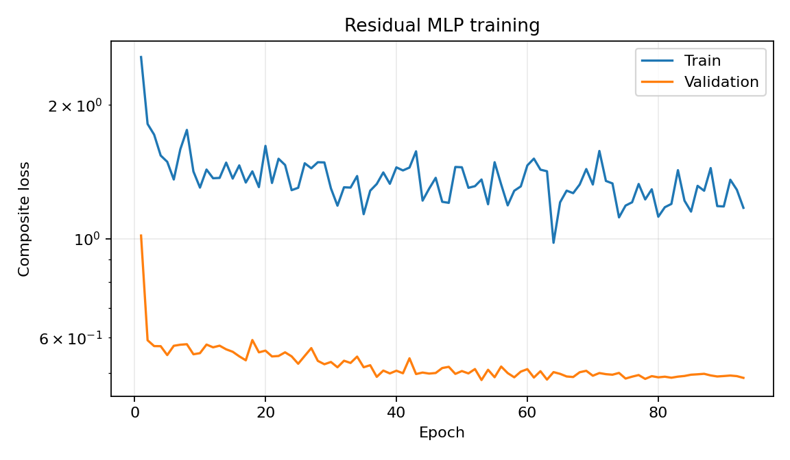
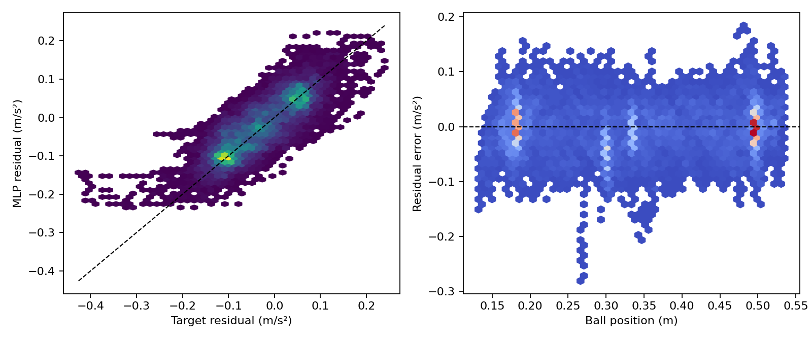
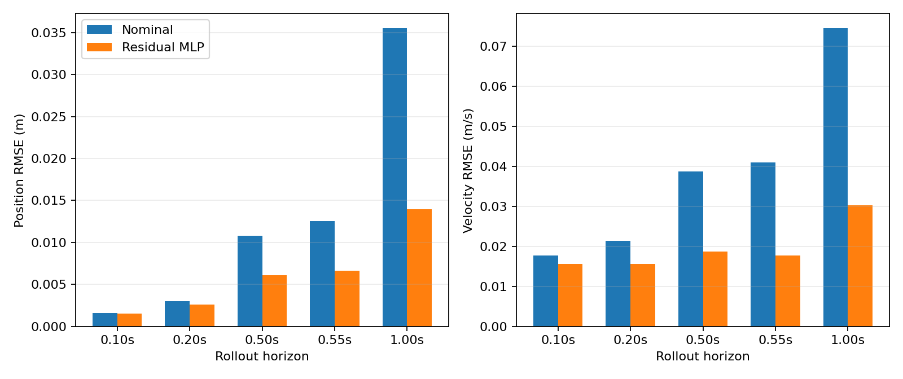
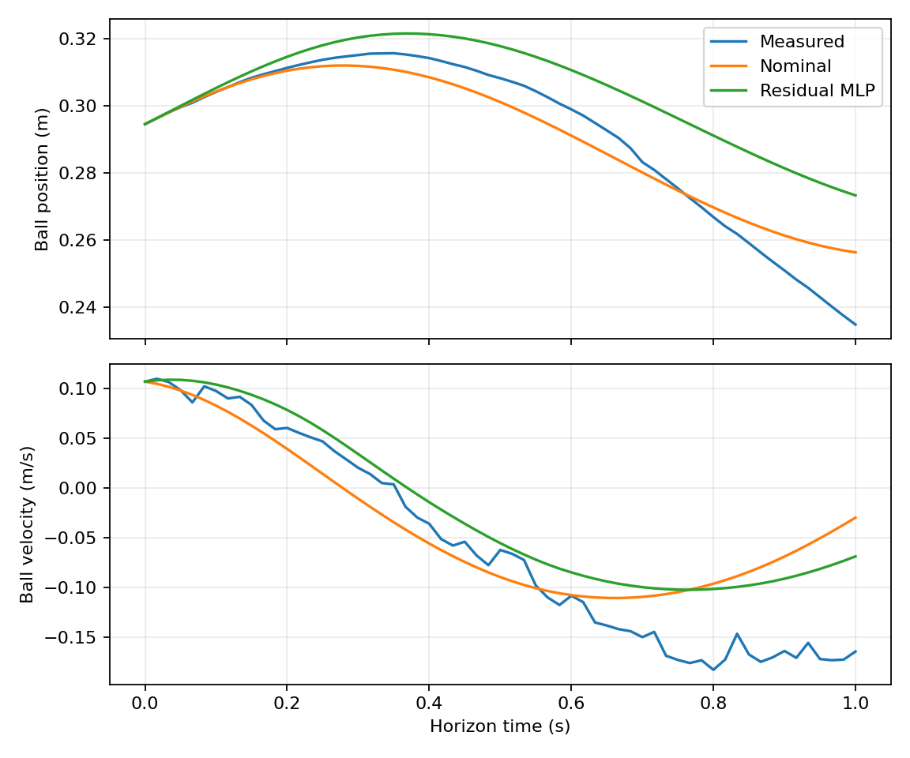

# 部署同构的因果加速度残差模型

## 1. 目标、适用边界与核心思想

本方案在加速度残差模型 v1.0 的网络结构和导出契约保持不变的前提下，
改变训练数据契约、多步 rollout 动力学和局部 Jacobian 约束，使训练时模型
看到的状态递推过程尽可能接近 C++ 状态预测器和 NMPC 中的实际部署过程。

球的总加速度仍写为

$$
a_b=a_{\mathrm{nom}}+r_a,
\qquad
r_a=f_\phi(p_b,v_b,\theta,\omega,a_{\mathrm{nom}}).
$$

这里的关键变化不是增加新的网络输入，而是把未来网络输入从“离线测量序列”
改为“由当前因果状态、pending-command 队列、未来 committed command、无人机
速度响应模型和完整系统动力学递推得到的状态”。因此，训练直接约束网络在闭环
预测轨迹上实际会访问的状态及其局部梯度，而不是只约束离线数据流形上的逐点输出。

本实验只修改 Python 离线识别流程。以下内容明确不在本方案范围内：

- 不改变 `5-16-16-1` MLP、输入顺序、`tanh` 激活或 `0.25 m/s²` 输出限幅；
- 不引入 v1.5 的死区、RNN、混合专家、碰撞模型或新的模型输入；
- 不实现控制器侧 residual scale 或 OOD 衰减；
- 不修改 C++ 状态预测器、acados NMPC 或实物控制器；
- 不重新采集实物数据。

因而，本报告评价的是“残差模型训练与离线预测契约是否更适合闭环部署”，而不是
对新的实物闭环控制性能作最终证明。

## 2. 与原 v1.0 训练方案的区别

| 项目 | 原 v1.0 | 因果 rollout 方案 |
| --- | --- | --- |
| 网络输入/结构 | `[pb,vb,theta,omega,a_nom]`，`5-16-16-1` | 完全相同 |
| rollout 初始状态 | SG 平滑后的 `pb,vb` | 部署可获得的 `obs_pb,obs_vb,obs_theta,obs_vrz` |
| 未来 `theta,omega` | 离线测量序列，作为外生真值输入 | 由命令、速度响应和几何关系递推 |
| 未来残差输入 | 部分来自离线测量状态 | 全部来自预测状态 |
| 命令延迟 | 不建模 | 显式重建 3 步 pending ring buffer |
| 无人机速度响应 | 不建模 | 使用每个 trial metadata 中的 `tau/gain/bias/max_velocity` |
| rollout 监督 | SG `pb,vb` | 因果观测为主，SG `pb,vb` 为 0.25 权重辅助目标 |
| 训练 horizon | `[6,12,30]` | `[6,12,30,33]` |
| Jacobian 位置 | 每个窗口的第一个离线特征 | 所有预测端点和所有 RK4 stage 状态 |
| Jacobian 坐标 | 归一化五输入梯度 | 最终残差关于 `[pb,vb,theta,vrz]` 的物理梯度 |
| 缓存/结果 | `processed`、`training`、`results` | 独立的 `processed_causal`、`training_causal`、`results_causal` |

旧版 processed schema 为版本 1，因果 schema 为版本 2，两者不兼容。因果配置
必须重新执行 `prepare`，不会读取或覆盖旧版缓存和训练权重。

## 3. 原始数据、试验划分与可复现性边界

数据来自 2026-08-15 的实物统一轨迹跟踪实验：

```text
logs/real_world/acados_nmpc_cpp/real_world_acados_unified_20260815
```

尽管 Laser 硬件名义频率更高，日志记录的是控制回调锁存后的状态，实际约为 60 Hz。
因此，本方案把数据解释为约 60 Hz 的闭环控制快照，而不是 240 Hz 原始 Laser 测量。

仅保留同时满足以下条件的 trial：

- `phase=tracking`；
- `end_reason=tracking_duration`；
- 所需因果状态、命令和 metadata 字段存在且有效。

固定划分为：

- 训练集：九组标准实验的 `trial_001`、`trial_002`，再加两组完成的
  `constant_035_2`，共 20 个 trial；
- 验证/最终离线评价集：九组标准实验的 `trial_003`，共 9 个 trial；
- 因 stale-beam 结束的 1 个 trial 排除。

验证集同时用于 early stopping 和最终离线评价，不是独立测试集。因此所有指标都是
开发集估计，不能被解释为对新实验日期、新装置状态或实物闭环稳定性的无偏估计。

manifest 保存原始 CSV/metadata 和 processed NPZ 的 SHA-256、固定划分、配置 hash、
processed array schema、训练集归一化统计和数据集 hash。`prepare` 之后，训练和评价只
读取 processed NPZ，不再访问原始 CSV。

当前 schema/provenance 为：

```text
manifest_version: 2
base_config_hash: 2d5dbe77cbc7a568bac22805b07bbf4e710a186cf919c7efc18b5f04419869b6
dataset_hash: f0c9432b5835759f59591a753610675bc9192f1f0a4a0edb11ea106b6e6ef098
```

## 4. 因果数据契约

### 4.1 必需日志字段

每个 tracking 样本需要以下字段：

| 类型 | 字段 |
| --- | --- |
| 时间/阶段 | `t_trial`, `phase` |
| 因果状态 | `obs_pb`, `obs_vb`, `obs_theta`, `obs_vrz` |
| 当前 committed command | `nmpc_command_z` |
| 稀疏队列诊断 | `pending_command_0`, `pending_command_1`, `pending_command_2` |

其中 `obs_pb/obs_vb/obs_theta/obs_vrz` 是部署时可获得的因果观测。未来观测只作为
rollout 监督目标，绝不会作为未来一步 MLP 输入。

每个 trial 还必须从 metadata 读取：

```text
predictor.delay_steps
controller.response.enabled
controller.response.tau_s
controller.response.gain
controller.response.bias
controller.constraints.max_velocity
controller.model.ball_mass
controller.model.ball_radius
controller.model.ball_inertia_ratio
controller.model.plank_length
controller.model.rope_length
controller.model.ball_position_offset
controller.model.gravity
```

配置固定三个 pending 字段，并要求 `predictor.delay_steps=3` 与字段数量严格一致。

### 4.2 时间处理、间隙与无效窗口

tracking 时间戳必须严格递增。对每个连续段：

1. 以原始时间差中位数作为该段的 $\Delta t$；
2. 因果状态用线性插值对齐到等间隔网格；
3. 命令使用零阶保持：查询时刻只使用最近一次已经 committed 的命令，不对命令作
   线性插值；
4. causal pipeline 使用严格的 `1.5 × median(dt)` 间隙阈值，以便单个无效/缺失命令
   样本也会切断序列；配置中的通用 gap factor 仍记录为 2.5；
5. 队列诊断不一致的行在前后分别建立边界，使该行成为短的独立片段并被丢弃；
6. 任何窗口都不能跨越 `segment_id`，因此不会跨越时间间隙、无效命令或队列重置；
7. 原始连续段少于 98 个样本，或处理后不足以支持 60 步评价的片段被拒绝；
8. 每段首尾各丢弃 15 个样本，避免 SG 边缘误差和命令历史不完整。

线性插值只用于把观测和监督目标对齐到控制时间网格；rollout 开始后，不再使用任何
未来插值状态来构造模型输入。

### 4.3 SG 辅助状态和逐点残差标签

因果 `obs_pb` 是主监督来源。在同一因果位置序列上使用 31 点、三阶
Savitzky-Golay 滤波，得到

$$
p_b^{\mathrm{SG}},\qquad
v_b^{\mathrm{SG}},\qquad
a_b^{\mathrm{SG}}.
$$

因果方案不对 `obs_theta` 或 `obs_vrz` 使用离线 SG 结果来构造 rollout 状态；配置中
保留的 theta 和 drone-velocity SG 参数是旧 preprocessing schema 的兼容字段，因果
路径的实际状态仍是 `obs_theta/obs_vrz` 的时间对齐值。

逐点辅助残差标签为

$$
r_a^{\mathrm{label}}
=a_b^{\mathrm{SG}}
-a_{\mathrm{nom}}(p_b^{\mathrm{causal}},
                   \theta^{\mathrm{causal}},
                   \omega^{\mathrm{causal}}).
$$

也就是说，加速度标签来自 SG 二阶导数，但名义加速度在因果状态上计算，避免用离线
平滑状态定义一个部署时不可复现的 nominal/residual 分解。

## 5. pending-command 队列与 C++ commit 语义

日志中的 pending 字段是当前命令完成 commit 之后的 ring buffer。对于固定三步延迟，
第 $k$ 行非空诊断应满足

$$
\mathbf q_k=[u_{k-2},u_{k-1},u_k].
$$

日志为减少体积只在部分行写出 pending 诊断。因此实现采用两层处理：

- 使用所有非空 `pending_command_0..2` 对 committed-command 历史作精确断言，允许的
  最大误差为 $10^{-9}$；没有任何非空诊断的片段被拒绝；
- 通过已验证的 committed-command 序列为每一个处理后时刻重建完整 pending queue。

一个从时刻 $k$ 开始、长度为 $H$ 的 rollout 使用命令序列

$$
[q_{k,0},q_{k,1},q_{k,2},u_{k+1},u_{k+2},\ldots].
$$

即前三个区间消费窗口开始时已经 pending 的命令，之后才消费窗口内未来记录的
committed commands。每个训练/验证 batch 都再次将这条重建序列与逐时刻
`response_command` 对比；任何大于 $10^{-9}$ 的差异都会立即终止运行，而不是静默训练。

## 6. 无人机垂直速度响应模型

速度响应参数按 trial 从 metadata 读取，不在残差网络中学习。令当前区间被执行的
命令为 $u_k$，响应目标为

$$
v_{rz}^{\star}=k_vu_k+b_v.
$$

若响应模型启用且 $\tau>0$，由区间开始速度 $v_{rz,k}$ 解析计算 RK4 所需的三个速度：

$$
v_{rz}^{\mathrm{start}}=v_{rz,k},
$$

$$
v_{rz}^{\mathrm{half}}
=v_{rz}^{\star}
+(v_{rz,k}-v_{rz}^{\star})e^{-\Delta t/(2\tau)},
$$

$$
v_{rz}^{\mathrm{end}}
=v_{rz}^{\star}
+(v_{rz,k}-v_{rz}^{\star})e^{-\Delta t/\tau}.
$$

若响应未启用或 $\tau=0$，三个 stage 直接使用目标速度。若 metadata 给出正的最大
速度，则所有 stage 都截断到 $[-v_{\max},v_{\max}]$。

当前 2026-08-15 数据中的典型响应参数为：

```text
enabled=true, tau=0.187 s, gain=1.0, bias=-0.00485 m/s,
max_velocity=3.0 m/s, delay_steps=3
```

这些值仍按 trial 独立保存和装入 batch；代码不假设所有 trial 必须完全相同。

## 7. 部署同构的完整动力学

### 7.1 状态、几何和名义模型

rollout 状态为

$$
\mathbf s=[p_b,v_b,\theta,v_{rz}]^\top.
$$

梁-绳几何与控制器一致：

$$
\sin\beta=\frac{L}{R}(1-\cos\theta),
\qquad
\omega=-\frac{v_{rz}\cos\beta}{L\cos(\beta-\theta)}.
$$

`asin` 输入截断到 $[-1+10^{-9},1-10^{-9}]$；接近零的几何分母按原符号截断到
$10^{-9}$，防止非有限数值。

球的名义加速度为

$$
a_{\mathrm{nom}}
=\gamma\left[(p_b+p_0-L)\omega^2-g\sin\theta\right].
$$

其中

$$
\gamma=\frac{m}{m+I/r^2},
\qquad I=c_I mr^2,
$$

所有物理常数均来自 trial metadata。当前数据的典型值为
$L=1.06$ m、$R=0.9$ m、$p_0=0.33$ m、$g=9.81$ m/s²、
$\gamma=1/1.4$。

### 7.2 连续动力学

每个 RK4 stage 的物理导数为

$$
\dot p_b=v_b,
$$

$$
\dot v_b=a_{\mathrm{nom}}(p_b,\theta,\omega)
+f_\phi(p_b,v_b,\theta,\omega,a_{\mathrm{nom}}),
$$

$$
\dot\theta=\omega(\theta,v_{rz}).
$$

$v_{rz}$ 不作为第四个常微分方程用 RK4 近似，而是使用上一节的精确一阶响应值为
k1/k2/k3/k4 分别提供 `start/half/half/end` 速度。

### 7.3 每个区间的 RK4 语义

令 $\mathbf x=[p_b,v_b,\theta]$，则

$$
\begin{aligned}
k_1 &= F(\mathbf x_k,v_{rz}^{\mathrm{start}}),\\
k_2 &= F(\mathbf x_k+\tfrac12\Delta t k_1,v_{rz}^{\mathrm{half}}),\\
k_3 &= F(\mathbf x_k+\tfrac12\Delta t k_2,v_{rz}^{\mathrm{half}}),\\
k_4 &= F(\mathbf x_k+\Delta t k_3,v_{rz}^{\mathrm{end}}),\\
\mathbf x_{k+1}
&=\mathbf x_k+\frac{\Delta t}{6}(k_1+2k_2+2k_3+k_4).
\end{aligned}
$$

在每一个 k1–k4 状态上，都会从当前预测的 $\theta,v_{rz}$ 重新计算
$\beta,\omega,a_{\mathrm{nom}}$ 和 MLP 残差。不存在使用区间端点平均
`theta/omega`、复用离线 `a_nom` 或 teacher forcing 未来梁状态的路径。

rollout 同时返回：

- 采样端点状态，shape 为 `[batch, H+1, 4]`；
- 所有实际调用 MLP 的 RK4 stage 状态，shape 为 `[batch, H, 4, 4]`。

对于训练 horizon $H=33$，每个窗口有 34 个端点和 132 个 stage，共 166 个用于
Jacobian 约束的状态。

## 8. 残差网络与导出格式

网络输入仍为

$$
\boldsymbol\phi(\mathbf s)
=[p_b,v_b,\theta,\omega(\theta,v_{rz}),a_{\mathrm{nom}}]^\top.
$$

输入先使用训练集统计量标准化：

$$
\bar{\boldsymbol\phi}
=\frac{\boldsymbol\phi-\boldsymbol\mu}{\boldsymbol\sigma}.
$$

MLP 为

$$
h_1=\tanh(W_0\bar{\boldsymbol\phi}+b_0),
$$

$$
h_2=\tanh(W_1h_1+b_1),
$$

$$
r_a=0.25\tanh(W_2h_2+b_2)\ \mathrm{m/s^2}.
$$

全部训练和导出使用 float64。最后一层权重和偏置初始化为零，因此初始网络严格输出
零残差，初始 rollout 等于名义模型。

portable NPZ 格式与 v1.0 完全一致，包含：

```text
input_mean, input_std, output_limit_mps2, metadata_json,
layer_0_weight, layer_0_bias,
layer_1_weight, layer_1_bias,
layer_2_weight, layer_2_bias
```

metadata 记录 config hash、dataset hash、最佳 epoch、训练设备和 W&B provenance。
因此现有 C++/NumPy 权重读取契约无需因因果训练而改变。

## 9. 归一化、OOD 边界和 Jacobian 状态尺度

MLP 输入均值、标准差、最小值和最大值只由 20 个训练 trial 的因果特征计算。
验证集不参与归一化或 OOD 边界估计。当前训练集统计基于 35,396 个样本。

| 特征 | mean | std | min | max |
| --- | ---: | ---: | ---: | ---: |
| $p_b$ | 0.34070751 | 0.11718293 | 0.12630001 | 0.69629992 |
| $v_b$ | -0.00407219 | 0.10236310 | -0.70750810 | 0.36869664 |
| $\theta$ | -0.00444982 | 0.02621938 | -0.23204396 | 0.16009750 |
| $\omega$ | 0.00430693 | 0.08796856 | -0.94011393 | 0.80635521 |
| $a_{\mathrm{nom}}$ | 0.02913396 | 0.18214988 | -1.11707264 | 1.61139942 |

OOD 判据为任一五维特征超出训练集逐维 min/max。评价分别报告：

- 验证集因果观测特征的 OOD 比例；
- 所有预测端点和 RK4 stage 特征的 rollout-state OOD 比例。

Jacobian 使用四维物理状态的典型单周期扰动尺度。对训练集中同一 segment 的相邻
因果状态差取绝对值，再逐维取 P95：

$$
\mathbf w_s
=\operatorname{P95}_{\mathrm{train}}
|\mathbf s_{k+1}-\mathbf s_k|.
$$

低于 $10^{-6}$ 的尺度会被截断。当前 manifest 中的固定尺度为：

| 状态 | P95 单周期尺度 |
| --- | ---: |
| $p_b$ | 0.0035032085 m |
| $v_b$ | 0.0341182844 m/s |
| $\theta$ | 0.0032743991 rad |
| $v_{rz}$ | 0.0213454246 m/s |

这些数值写入 manifest，训练、验证和报告必须读取同一份数值，不能在验证集上重估。
对应的 manifest 字段名为 `state_scale_names` 和 `state_scales`。

## 10. 双监督 rollout 损失

训练窗口长度为 33 个控制区间。监督 horizon 和权重为：

| step | 约对应时间 | 权重 $\alpha_h$ |
| ---: | ---: | ---: |
| 6 | 0.10 s | 0.15 |
| 12 | 0.20 s | 0.20 |
| 30 | 0.50 s | 0.30 |
| 33 | 0.55 s | 0.35 |

因果主目标为

$$
\mathcal L_{p,c}
=\sum_h\alpha_h
\frac{\mathbb E[(\hat p_{b,h}-p_{b,h}^{\mathrm{causal}})^2]}
{(0.01\ \mathrm m)^2},
$$

$$
\mathcal L_{v,c}
=\sum_h\alpha_h
\frac{\mathbb E[(\hat v_{b,h}-v_{b,h}^{\mathrm{causal}})^2]}
{(0.05\ \mathrm{m/s})^2}.
$$

SG 辅助目标使用完全相同的尺度和 horizon，记为
$\mathcal L_{p,\mathrm{SG}}$、$\mathcal L_{v,\mathrm{SG}}$，总 rollout 项为

$$
\mathcal L_{\mathrm{rollout}}
=\mathcal L_{p,c}+\mathcal L_{v,c}
+0.25(\mathcal L_{p,\mathrm{SG}}+\mathcal L_{v,\mathrm{SG}}).
$$

因果目标保持与部署观测一致；SG 目标只提供较低噪声的辅助方向，不替代因果主目标。

逐点 Huber loss 在窗口内所有 processed 因果观测特征上计算；它不使用预测 RK4
stage 作为逐点标签：

$$
\mathcal L_{r}
=\operatorname{Huber}_{\delta=0.02}
(f_\phi(\boldsymbol\phi),r_a^{\mathrm{label}}).
$$

`theta` 和 `vrz` 的预测 RMSE 只记录为响应链诊断，不进入 loss。残差网络无法直接
改变这两个状态；若响应模型错误，评价必须通过响应链门槛拒绝候选。不过，球的
rollout loss 仍可能使残差间接补偿一部分响应误差，这是该方法的剩余局限，而不是
由额外 `theta/vrz` loss 可以消除的问题。

## 11. 全 rollout 物理 Jacobian 约束

对最终有界残差关于部署物理状态求导：

$$
J_r^s(\mathbf s)
=\frac{\partial f_\phi(\boldsymbol\phi(\mathbf s))}
{\partial[p_b,v_b,\theta,v_{rz}]}.
$$

这里的梯度包括完整链式关系，例如 $v_{rz}\rightarrow\omega\rightarrow a_{\mathrm{nom}}
\rightarrow r_a$，不是简单的五输入网络权重范数。

每个 batch 先执行真实因果 rollout，再将全部端点和全部 k1–k4 stage 状态拼接并
`detach()`，随后重新启用状态梯度。这一处理有两个目的：

- Jacobian 约束施加在当前模型真正访问的状态分布上；
- 不让某个时刻的局部 Jacobian penalty 通过整段 rollout 历史反向传播，但仍保留
  Jacobian loss 对网络参数所需的二阶自动微分。

无量纲的单周期残差变化范数为

$$
q(\mathbf s)=\|J_r^s(\mathbf s)\operatorname{diag}(\mathbf w_s)\|_2.
$$

使用 hinge 而不是零梯度惩罚：

$$
\mathcal L_J
=\mathbb E\left[
\operatorname{ReLU}
\left(\frac{q(\mathbf s)}{L_{\max}}-1\right)^2
\right].
$$

因此 $q\le L_{\max}$ 的真实位置相关坡度不受惩罚，只压制超过允许上限的局部变化，
不会把已被实验证实的位置坡度统一压向零。

默认配置为

$$
L_{\max}=0.02\ \mathrm{m/s^2},
\qquad \lambda_J=0.1.
$$

完整训练目标为

$$
\boxed{
\mathcal L
=\mathcal L_{\mathrm{rollout}}
+0.25\mathcal L_r
+0.1\mathcal L_J
}.
$$

原 v1.0 的 `loss.jacobian_weight` 在因果配置中设为零；因果 Jacobian 只由
`causal_rollout.jacobian_weight` 控制，避免同时施加两套定义不同的梯度正则。

## 12. 采样、优化、验证与设备选择

所有合法窗口以 stride 1 建立。训练 batch 先均匀选择 trial，再在该 trial 内均匀选择
负速度、低速和正速度 regime，最后均匀选择窗口。regime 只控制采样平衡，网络仍然
只有一个。

正式训练超参数为：

| 参数 | 数值 |
| --- | ---: |
| batch size | 128 |
| steps/epoch | 32 |
| max epochs | 500 |
| AdamW learning rate | 0.001 |
| weight decay | $10^{-5}$ |
| gradient clipping | 1.0 |
| LR plateau patience/factor | 10 / 0.5 |
| early-stopping patience | 40 |
| validation stride | 5 |
| validation max windows | 2048 |

正式基线 seed 为 7；受控复验还使用 17 和 27。Python、NumPy、PyTorch 和 CUDA seed
均固定，并启用 PyTorch deterministic algorithms。

因果模型验证 loss 在 Jacobian 权重大于零时也计算完整 Jacobian 项，最佳 checkpoint
按完整验证目标选择，而不是只按 rollout RMSE 选择。

运行设备为 `auto` 时，CPU 和 CUDA 分别执行相同的完整训练 step，包括因果 RK4、
全状态 Jacobian、二阶反向传播和 optimizer update。CUDA 中位耗时至少快 20% 才会
被选中；设备 benchmark 的模型状态会被丢弃，正式训练重新设置 seed。最终评价固定
在 CPU/float64 上执行。

W&B 默认为 online-first，连接失败时退回 offline。受控筛选可显式使用
`--wandb-mode disabled`。日志包含 batch/epoch loss、各 horizon 指标、梯度范数、
参数直方图、学习率、时间和设备信息；原始 CSV、完整 processed 数据及权重不会上传。

## 13. 离线评价指标与单模型验收

### 13.1 评价内容

验证集同时评价残差模型和名义模型。两者使用完全相同的初始因果状态、pending queue、
未来 command、速度响应和完整动力学；名义模型仅令 $r_a=0$。

报告的 rollout horizon 为 `[6,12,30,33,60]`，约对应
`[0.1,0.2,0.5,0.55,1.0] s`，并同时报告：

- 因果 `pb/vb` 目标的 nominal/MLP RMSE 和 MSE 改善率；
- SG `pb/vb` 辅助目标的 nominal/MLP RMSE；
- response-only `theta/vrz` RMSE 和 bias；
- 按轨迹、位置区间和速度 regime 分组的误差；
- 逐点 residual RMSE、MAE、bias、R² 和输出饱和率；
- 命令队列对齐 RMSE/max；
- 观测特征和 rollout-state OOD 比例；
- 所有端点/stage 上 $q(\mathbf s)$ 的 P50/P95/P99/max；
- 相邻预测端点的 $|r_{a,k+1}-r_{a,k}|$ P50/P95/P99/max。

### 13.2 单模型验收条件

单个训练 run 必须同时满足：

- residual RMSE $\le0.05$ m/s²；
- 30 步因果位置和速度 MSE 相对 nominal 均至少改善 30%；
- 任一动态轨迹在 33 步时的 `pb` 或 `vb` RMSE 相对 nominal 退化不超过 10%；
- constant 且 $|v_b|\le0.02$ m/s 的样本上，总预测加速度中位数
  $\le0.02$ m/s²；
- 残差达到输出限幅 95%（即 $|r_a|\ge0.2375$ m/s²）的比例 $\le1\%$；
- 输出和物理 Jacobian 全部有限；
- 命令队列最大对齐误差 $\le10^{-9}$ m/s；
- Jacobian P99 $\le1.25L_{\max}$；
- Jacobian max $\le2L_{\max}$；
- 60 步响应链满足 $|\operatorname{bias}(\theta)|\le0.005$ rad 且
  $|\operatorname{bias}(v_{rz})|\le0.02$ m/s。

响应链门槛失败时，即使球的 rollout 指标很好，也标记
`eligible_for_real_world_test=false`，禁止残差模型以球误差改善为理由掩盖无人机响应
模型的系统偏差。

## 14. Jacobian 小规模筛选和三 seed 协议

预定义初筛包含四组：

| 候选 | Jacobian 权重 | $L_{\max}$ |
| --- | ---: | ---: |
| `jacobian_off` | 0.0 | 0.02（只用于评价门槛） |
| `lmax_0p01` | 0.1 | 0.01 m/s² |
| `lmax_0p02` | 0.1 | 0.02 m/s² |
| `lmax_0p04` | 0.1 | 0.04 m/s² |

初筛固定 seed 7，使用相同的短预算：16 steps/epoch、最多 80 epochs、early-stopping
patience 20、最多 1024 个验证窗口。先应用以下硬过滤：

- Jacobian P99 和 max 门槛；
- residual RMSE $\le0.05$ m/s²；
- 所有动态轨迹 33 步退化不超过 10%；
- response-chain bias 通过；
- command queue 对齐通过。

在剩余候选中，选择归一化 33 步因果综合分数最低者：

$$
S_{33}
=\left(\frac{\operatorname{RMSE}(p_b)}{0.01}\right)^2
+\left(\frac{\operatorname{RMSE}(v_b)}{0.05}\right)^2.
$$

短筛选胜出者再使用正式完整预算分别训练 seeds `7/17/27`。只有三个正式 run 都通过
上述 screening hard filters，才令 `seed_stability_passed=true` 并产生最终
`selected_run_dir`。短筛选胜出但任一正式 seed 失败时，最终候选必须为空；不能挑选
三个 seed 中表现最好的一个进入实物测试。

`screening_summary.json` 还记录旧 v1.0 的逐点和 30 步指标作为背景。但旧 v1.0 使用
teacher-forced 梁状态及不同监督目标，其绝对 rollout 数值不能与因果 rollout 作严格
同口径排名。

## 15. 产物隔离、模型身份与防误用检查

因果方案使用独立路径：

```text
processed: residual_dynamics/data/processed_causal
training:  residual_dynamics/runs/training_causal
wandb:     residual_dynamics/runs/wandb_causal
results:   residual_dynamics/results_causal
report:    residual_dynamics/REPORT_CAUSAL.md
```

每个训练 run 的目录名包含 seed、有效配置 hash 和时间戳。目录内保存：

```text
best_checkpoint.pt
weights.npz
history.csv
training_summary.json
evaluation_summary.json
validation_predictions.npz
```

不同 seed、Jacobian 权重和 $L_{\max}$ 会获得不同 config hash 和模型 ID。评价时要求
checkpoint config hash 与当前 seed/Jacobian override 完全一致；若 `latest.json` 指向
另一候选，评价会拒绝运行，而不会用错误门槛解释其结果。

筛选稳定性失败时，训练权重仍作为诊断产物保留，但 `selected_candidate` 和
`selected_run_dir` 均为空，表示没有权重被批准进入实物测试。

## 16. 复现命令

从仓库根目录重新生成因果缓存：

```bash
conda run -n isaac-sim python -m residual_dynamics.cli prepare \
  --config residual_dynamics/configs/mlp_5input_causal_rollout.yaml
```

训练、评价和生成报告：

```bash
conda run -n isaac-sim python -m residual_dynamics.cli train \
  --config residual_dynamics/configs/mlp_5input_causal_rollout.yaml

conda run -n isaac-sim python -m residual_dynamics.cli evaluate \
  --config residual_dynamics/configs/mlp_5input_causal_rollout.yaml \
  --run-dir /path/to/exact/run

conda run -n isaac-sim python -m residual_dynamics.cli report \
  --config residual_dynamics/configs/mlp_5input_causal_rollout.yaml
```

受控筛选和三 seed 正式复验：

```bash
conda run -n isaac-sim python -m residual_dynamics.cli screen \
  --config residual_dynamics/configs/mlp_5input_causal_rollout.yaml \
  --wandb-mode disabled
```

单独复现某个候选时必须使用与训练一致的 override，例如：

```bash
conda run -n isaac-sim python -m residual_dynamics.cli train \
  --config residual_dynamics/configs/mlp_5input_causal_rollout.yaml \
  --seed 17 --jacobian-weight 0.1 --jacobian-limit 0.04
```

测试命令：

```bash
conda run -n isaac-sim python -m pytest residual_dynamics/tests -q
```

测试覆盖命令零阶保持、pending queue 消费顺序、稀疏诊断与 reset 检出、metadata 响应
参数、指数速度响应、完整 RK4 常加速度解析解、几何有限性、端点/stage Jacobian 的
shape/解析值/参数梯度、segment 窗口边界，以及旧版和因果版 synthetic end-to-end
流水线。

<!-- BEGIN GENERATED RESULTS -->
## 实际训练与验证结果

- Run：`mlp5_seed27_f2474141_20260819_162857`
- 随机种子：`27`
- 最佳 epoch：`53`（停止原因：`early_stopping`）
- 训练设备：`cpu`
- CPU/GPU 基准：CUDA unavailable
- 总训练时间：264.0 s
- W&B 模式：`disabled`；Run ID：`N/A`
- W&B 链接：N/A（本地 offline run）
- 当前单模型验收：**PASS**
- 总体验收：**FAIL**

### 逐点加速度残差

| 模型 | RMSE (m/s²) | MAE (m/s²) | Bias (m/s²) | R² |
| --- | ---: | ---: | ---: | ---: |
| 名义模型 | 0.084251 | 0.070277 | 0.031549 | -0.1631 |
| 五输入 MLP | 0.045246 | 0.034978 | 0.006496 | 0.6645 |

### 多步自由 rollout

| Horizon | 模型 | 位置 RMSE (m) | 速度 RMSE (m/s) | 位置 MSE 改善 | 速度 MSE 改善 |
| ---: | --- | ---: | ---: | ---: | ---: |
| 0.100 s | 名义模型 | 0.001567 | 0.017676 | — | — |
| 0.100 s | 五输入 MLP | 0.001500 | 0.015670 | 8.4% | 21.4% |
| 0.200 s | 名义模型 | 0.003031 | 0.021398 | — | — |
| 0.200 s | 五输入 MLP | 0.002570 | 0.015536 | 28.1% | 47.3% |
| 0.500 s | 名义模型 | 0.010797 | 0.038731 | — | — |
| 0.500 s | 五输入 MLP | 0.006089 | 0.018651 | 68.2% | 76.8% |
| 0.550 s | 名义模型 | 0.012540 | 0.040922 | — | — |
| 0.550 s | 五输入 MLP | 0.006653 | 0.017701 | 71.9% | 81.3% |
| 1.000 s | 名义模型 | 0.035496 | 0.074446 | — | — |
| 1.000 s | 五输入 MLP | 0.013941 | 0.030259 | 84.6% | 83.5% |

### SG 辅助目标与响应链诊断

| Horizon | SG目标 MLP位置 RMSE | SG目标 MLP速度 RMSE | theta RMSE / bias | vrz RMSE / bias |
| ---: | ---: | ---: | ---: | ---: |
| 0.100 s | 0.001359 | 0.012477 | 0.001158 / 0.000410 rad | 0.015253 / -0.000727 m/s |
| 0.200 s | 0.002484 | 0.013093 | 0.002662 / 0.000856 rad | 0.019492 / -0.001055 m/s |
| 0.500 s | 0.006008 | 0.015148 | 0.007680 / 0.002304 rad | 0.022487 / -0.001228 m/s |
| 0.550 s | 0.006652 | 0.015576 | 0.008496 / 0.002555 rad | 0.022579 / -0.001376 m/s |
| 1.000 s | 0.013928 | 0.028145 | 0.015078 / 0.004766 rad | 0.023111 / -0.001243 m/s |

### Jacobian 受控筛选

- 短预算候选：`lmax_0p04`
- 三 seed 稳定性：**FAIL**
- 最终可导出候选：`无`

| 初筛候选 | 残差 RMSE | h33 pb/vb RMSE | Jacobian P99/max | 硬过滤 |
| --- | ---: | ---: | ---: | --- |
| `jacobian_off` | 0.048678 | 0.007057 / 0.019371 | 0.028131 / 0.028704 | FAIL |
| `lmax_0p01` | 0.045639 | 0.007113 / 0.019853 | 0.019221 / 0.019718 | FAIL |
| `lmax_0p02` | 0.047915 | 0.007030 / 0.019289 | 0.026636 / 0.027191 | FAIL |
| `lmax_0p04` | 0.048678 | 0.007057 / 0.019371 | 0.028131 / 0.028704 | PASS |

| 正式复验 seed | 残差 RMSE | h33 pb/vb RMSE | Jacobian P99/max | 硬过滤 |
| ---: | ---: | ---: | ---: | --- |
| 7 | 0.045483 | 0.006376 / 0.017010 | 0.076554 / 0.092958 | FAIL |
| 17 | 0.045880 | 0.006704 / 0.018182 | 0.048620 / 0.059571 | PASS |
| 27 | 0.045246 | 0.006653 / 0.017701 | 0.041433 / 0.043714 | PASS |

### 分轨迹的 0.5 s rollout

| 轨迹 | 名义位置 RMSE | MLP位置 RMSE | 位置MSE改善 | 名义速度 RMSE | MLP速度 RMSE | 速度MSE改善 |
| --- | ---: | ---: | ---: | ---: | ---: | ---: |
| `constant_015` | 0.008444 | 0.003404 | 83.7% | 0.034016 | 0.010537 | 90.4% |
| `constant_035` | 0.009618 | 0.006221 | 58.2% | 0.036491 | 0.020530 | 68.3% |
| `constant_055` | 0.014885 | 0.006212 | 82.6% | 0.053736 | 0.017592 | 89.3% |
| `sine_period_6` | 0.007654 | 0.005707 | 44.4% | 0.026089 | 0.017534 | 54.8% |
| `sine_period_8` | 0.009045 | 0.005567 | 62.1% | 0.032576 | 0.017834 | 70.0% |
| `trapezoid_period_6` | 0.013812 | 0.008623 | 61.0% | 0.047264 | 0.026075 | 69.6% |
| `trapezoid_period_8` | 0.011257 | 0.006880 | 62.6% | 0.036360 | 0.020342 | 68.7% |
| `triangle_period_6` | 0.011143 | 0.005770 | 73.2% | 0.041321 | 0.017258 | 82.6% |
| `triangle_period_8` | 0.009045 | 0.005127 | 67.9% | 0.033458 | 0.016482 | 75.7% |

### 分速度状态的逐点残差

| 速度状态 | 样本数 | 名义RMSE (m/s²) | MLP RMSE (m/s²) | MLP Bias (m/s²) |
| --- | ---: | ---: | ---: | ---: |
| `low_speed` | 5937 | 0.088350 | 0.040928 | 0.008514 |
| `negative` | 5041 | 0.073117 | 0.046821 | 0.016899 |
| `positive` | 4949 | 0.089632 | 0.048435 | -0.006523 |

### 分位置区间的逐点残差

| 位置区间 (m) | 样本数 | 名义RMSE (m/s²) | MLP RMSE (m/s²) | MLP R² |
| --- | ---: | ---: | ---: | ---: |
| `[0.126,0.240)` | 4860 | 0.068178 | 0.043046 | 0.5429 |
| `[0.240,0.354)` | 4319 | 0.080373 | 0.052150 | 0.4514 |
| `[0.354,0.468)` | 2713 | 0.092818 | 0.044705 | 0.5328 |
| `[0.468,0.582)` | 4035 | 0.098550 | 0.039929 | 0.6856 |

### 诊断与验收

- 验证样本 OOD 比例：0.00%
- 残差输出饱和比例：0.000%
- 静止段总预测加速度中位数：0.017444 m/s²
- 物理状态无量纲 Jacobian范数 P99：0.0414
- Rollout 状态 OOD 比例：0.18%
- 物理 Jacobian 范数 P50/P95/P99/max：0.025921 / 0.039808 / 0.041433 / 0.043714 m/s²
- 相邻预测状态残差变化 P95/P99/max：0.011368 / 0.017719 / 0.038605 m/s²
- 命令队列对齐 RMSE/max：0.000e+00 / 0.000e+00 m/s
- 响应链系统偏差：未检测到

| 验收项 | 结果 |
| --- | --- |
| `all_dynamic_groups_no_large_degradation` | PASS |
| `command_queue_alignment` | PASS |
| `finite_outputs_and_gradients` | PASS |
| `h30_position_improvement` | PASS |
| `h30_velocity_improvement` | PASS |
| `jacobian_max_within_limit` | PASS |
| `jacobian_p99_within_limit` | PASS |
| `residual_rmse` | PASS |
| `residual_saturation` | PASS |
| `response_chain_no_systematic_bias` | PASS |
| `static_total_acceleration` | PASS |

### 结果图









> 注意：同一验证集用于 early stopping 和最终离线评价，以上结果不是独立测试集上的无偏泛化估计。
<!-- END GENERATED RESULTS -->

## 17. 当前结论、限制与进入实物测试前的条件

当前结果表明，部署同构训练显著改善了离线多步预测：因果 rollout 在 30、33 和 60 步
均明显优于同一完整动力学下的 nominal 模型，响应链 bias、命令队列对齐和 OOD 指标
也没有显示明显的数据契约错误。这说明以下修改是有效的：

- 不再 teacher-force 未来 `theta/omega`；
- 用 pending queue 和未来 committed commands 重现部署命令时序；
- 用 metadata 速度响应递推 `vrz`；
- 在每个 RK4 stage 重算几何、nominal 和 residual；
- 使用因果主目标并保留低权重 SG 辅助目标。

但是，受控筛选没有产生最终可部署模型。短预算下 `Lmax=0.04` 是唯一通过者，正式
训练后 seed 7 的 Jacobian P99/max 超限，而 seeds 17/27 通过，导致三 seed 结论反转。
因此当前可靠结论是：

> 因果 rollout 设计改善了离线数值一致性，但固定权重 0.1 的 Jacobian hinge 尚不能
> 在不同随机种子下可靠保证最终局部梯度上限；当前没有模型被批准进入实物闭环测试。

仍需注意以下限制：

1. 数据仍来自同一日期的闭环约 60 Hz 日志，validation 兼作 early stopping 和最终
   评价，没有独立实验日期或独立装置状态测试；
2. SG 加速度仍是非因果离线标签，只是它不再被用作 rollout 的唯一状态契约；
3. 状态时间对齐使用线性插值，命令严格使用 ZOH，但没有原始 240 Hz Laser 数据来
   量化观测锁存和控制回调内部的亚周期相位误差；
4. 速度响应参数固定为 metadata 标称值，没有在每个 trial 内重新辨识；响应链 bias
   gate 能拒绝明显错误，但不能证明所有瞬态相位都正确；
5. 记忆无关的平滑 MLP 不能表示碰撞冲量、stick-slip、多值摩擦或未观测内部状态；
6. min/max OOD 只反映逐维边界，不度量训练特征的联合密度，也没有实现控制器侧 OOD
   scale 衰减；
7. Jacobian 约束只控制残差对单周期典型物理扰动的局部增益，不直接保证 NMPC 闭环
   稳定性、求解器收敛性或多步误差不会累积；
8. 短筛选和正式训练之间出现的 Jacobian 漂移说明，最佳 rollout checkpoint 与最佳
   Jacobian-safe checkpoint 可能不一致，当前 checkpoint 选择规则仍需改进。

进入实物测试前至少应满足：

- 重新设计 Jacobian 约束或 checkpoint 选择，使 7/17/27 三个完整训练 run 均通过
  P99/max 门槛；
- 在独立日期或新采集 trial 上重复因果 rollout、response-chain 和 OOD 评价；
- 用 C++ shadow predictor 对同一日志逐周期对齐 Python rollout，验证命令、响应和
  RK4 数值达到实现级一致；
- 只有 `screening_summary.json` 给出非空 `selected_run_dir` 后，才考虑配合控制器侧
  residual scale 与 OOD 衰减开展低权重、逐级放大的实物闭环试验。
