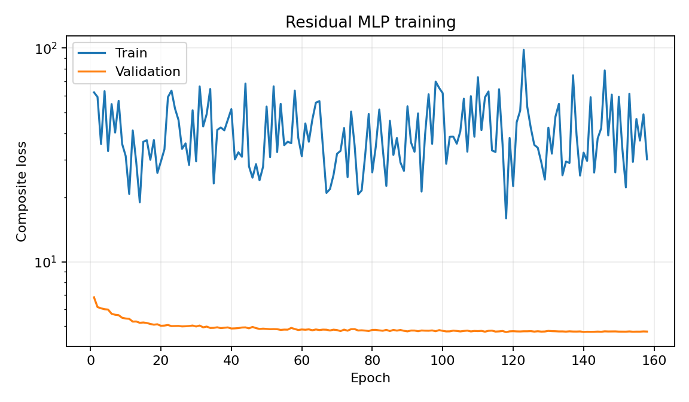
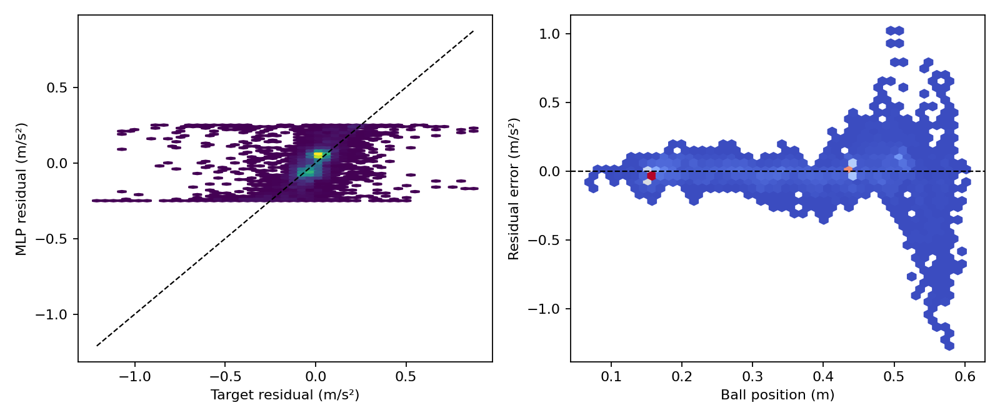
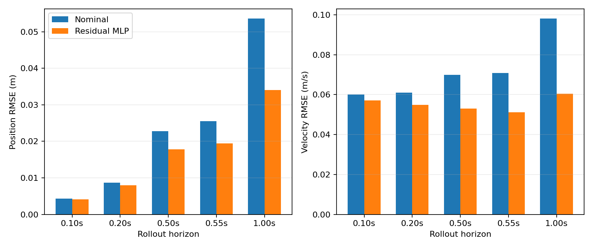
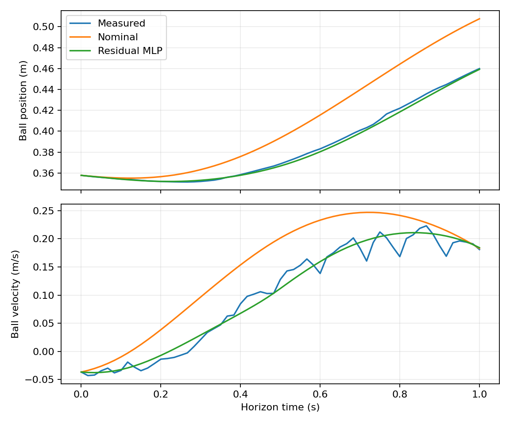

# success-only causal 模型 cap=0.25 单变量消融

## 实验问题

本实验用于区分当前多批次模型的变化来自 success-only 多批次数据，还是主要来自 residual
输出限幅由 `0.25` 放宽到 `0.5`。

相对于 cap=0.5 最终模型，固定以下内容不变：

- 六批 success-only train、validation、test 和 stress trial；
- 50% empirical + 50% coverage sampler；
- `5-16-16-1`、tanh、float64 和五维输入；
- causal/SG rollout loss、horizon 权重、point Smooth-L1 loss；
- `jacobian_off`，不重新筛选 Jacobian 候选；
- seed 7、AdamW、batch size、学习率、epoch 和 early stopping；
- validation RMSE 门限仍为 `0.15 m/s²`，且不参与训练 loss。

唯一影响模型优化的改动是：

```text
output_limit_mps2: 0.50 -> 0.25
```

产物路径和 W&B group 仅为实验隔离而改变。

## cap=0.25 的理论误差下界

对同一 residual 标签直接作最优有界投影，得到：

| Split | bounded-oracle RMSE | `|label|>0.25` |
| --- | ---: | ---: |
| train | 0.093998 | 4.324% |
| validation | 0.061740 | 6.037% |
| test | 0.155219 | 4.671% |
| stress | 0.299599 | 34.653% |

因此原始 `0.05 m/s²` 门限在 validation 上不可达；test 的 oracle 下界也略高于当前
`0.15 m/s²` 门限。本实验以连续指标和相对 cap=0.5 的变化为主要结论，不用单一
RMSE PASS/FAIL 判断 cap=0.25 是否有价值。

## 训练目标

完整训练目标与 cap=0.5 的 `jacobian_off` 最终模型一致：

$$
\mathcal L
=\mathcal L_{p,c}+\mathcal L_{v,c}
+0.25(\mathcal L_{p,\mathrm{SG}}+\mathcal L_{v,\mathrm{SG}})
+0.25\mathcal L_r.
$$

其中 rollout horizon/权重为 `6/12/30/33 -> 0.15/0.20/0.30/0.35`，位置和速度归一化
尺度为 `0.01 m/0.05 m/s`，$\mathcal L_r$ 为 `SmoothL1(beta=0.02)`。

## 复现命令

```bash
conda run -n isaac-sim python -m residual_dynamics.cli prepare \
  --config residual_dynamics/configs/mlp_5input_causal_success_cap0p25_ablation.yaml

conda run -n isaac-sim python -m residual_dynamics.cli train \
  --config residual_dynamics/configs/mlp_5input_causal_success_cap0p25_ablation.yaml \
  --wandb-mode disabled

conda run -n isaac-sim python -m residual_dynamics.cli evaluate \
  --config residual_dynamics/configs/mlp_5input_causal_success_cap0p25_ablation.yaml

conda run -n isaac-sim python -m residual_dynamics.cli report \
  --config residual_dynamics/configs/mlp_5input_causal_success_cap0p25_ablation.yaml
```

<!-- BEGIN GENERATED RESULTS -->
## 实际训练与验证结果

- Run：`mlp5_seed7_d92615c2_20260820_181854`
- 随机种子：`7`
- 最佳 epoch：`118`（停止原因：`early_stopping`）
- 训练设备：`cpu`
- CPU/GPU 基准：CUDA unavailable
- 总训练时间：351.0 s
- W&B 模式：`disabled`；Run ID：`N/A`
- W&B 链接：N/A（本地 offline run）
- 当前单模型验收：**FAIL**
- 总体验收：**FAIL**

### 逐点加速度残差

| 模型 | RMSE (m/s²) | MAE (m/s²) | Bias (m/s²) | R² |
| --- | ---: | ---: | ---: | ---: |
| 名义模型 | 0.135121 | 0.079713 | 0.015966 | -0.0142 |
| 五输入 MLP | 0.128538 | 0.072483 | 0.010007 | 0.0822 |

### 多步自由 rollout

| Horizon | 模型 | 位置 RMSE (m) | 速度 RMSE (m/s) | 位置 MSE 改善 | 速度 MSE 改善 |
| ---: | --- | ---: | ---: | ---: | ---: |
| 0.100 s | 名义模型 | 0.004310 | 0.060134 | — | — |
| 0.100 s | 五输入 MLP | 0.004149 | 0.057124 | 7.3% | 9.8% |
| 0.200 s | 名义模型 | 0.008657 | 0.061014 | — | — |
| 0.200 s | 五输入 MLP | 0.007950 | 0.054797 | 15.7% | 19.3% |
| 0.500 s | 名义模型 | 0.022756 | 0.069838 | — | — |
| 0.500 s | 五输入 MLP | 0.017768 | 0.053038 | 39.0% | 42.3% |
| 0.550 s | 名义模型 | 0.025499 | 0.070816 | — | — |
| 0.550 s | 五输入 MLP | 0.019432 | 0.051171 | 41.9% | 47.8% |
| 1.000 s | 名义模型 | 0.053559 | 0.098049 | — | — |
| 1.000 s | 五输入 MLP | 0.034085 | 0.060384 | 59.5% | 62.1% |

### SG 辅助目标与响应链诊断

| Horizon | SG目标 MLP位置 RMSE | SG目标 MLP速度 RMSE | theta RMSE / bias | vrz RMSE / bias |
| ---: | ---: | ---: | ---: | ---: |
| 0.100 s | 0.003949 | 0.037929 | 0.001496 / 0.000355 rad | 0.019209 / -0.001407 m/s |
| 0.200 s | 0.007512 | 0.042541 | 0.003526 / 0.000801 rad | 0.025145 / -0.002216 m/s |
| 0.500 s | 0.017718 | 0.041316 | 0.010150 / 0.002343 rad | 0.028717 / -0.002606 m/s |
| 0.550 s | 0.019375 | 0.041350 | 0.011202 / 0.002611 rad | 0.029096 / -0.002926 m/s |
| 1.000 s | 0.034074 | 0.050433 | 0.019613 / 0.005101 rad | 0.029143 / -0.002793 m/s |

### 独立 split 验收

| Split | trial 数 | h33 pb/vb RMSE | 验收 |
| --- | ---: | ---: | --- |
| `stress` | 5 | 0.086387 / 0.178662 | FAIL |
| `test` | 6 | 0.072000 / 0.189123 | FAIL |
| `validation` | 6 | 0.019432 / 0.051171 | FAIL |

### 分轨迹的 0.5 s rollout

| 轨迹 | 名义位置 RMSE | MLP位置 RMSE | 位置MSE改善 | 名义速度 RMSE | MLP速度 RMSE | 速度MSE改善 |
| --- | ---: | ---: | ---: | ---: | ---: | ---: |
| `constant_015` | 0.005439 | 0.005308 | 4.8% | 0.018903 | 0.017640 | 12.9% |
| `constant_035` | 0.007893 | 0.007741 | 3.8% | 0.027927 | 0.025696 | 15.3% |
| `sine_period_6` | 0.007994 | 0.007871 | 3.1% | 0.026728 | 0.025366 | 9.9% |
| `sine_period_8` | 0.025182 | 0.018766 | 44.5% | 0.080264 | 0.056252 | 50.9% |
| `trapezoid_period_8` | 0.035934 | 0.027925 | 39.6% | 0.110415 | 0.083266 | 43.1% |
| `triangle_period_8` | 0.032027 | 0.024741 | 40.3% | 0.093697 | 0.071874 | 41.2% |

### 分速度状态的逐点残差

| 速度状态 | 样本数 | 名义RMSE (m/s²) | MLP RMSE (m/s²) | MLP Bias (m/s²) |
| --- | ---: | ---: | ---: | ---: |
| `low_speed` | 3792 | 0.074894 | 0.074363 | 0.005043 |
| `negative` | 3451 | 0.162661 | 0.161577 | 0.040946 |
| `positive` | 3375 | 0.155188 | 0.138101 | -0.016052 |

### 分位置区间的逐点残差

| 位置区间 (m) | 样本数 | 名义RMSE (m/s²) | MLP RMSE (m/s²) | MLP R² |
| --- | ---: | ---: | ---: | ---: |
| `[0.000,0.100)` | 18 | 0.171339 | 0.047428 | -1.1751 |
| `[0.100,0.200)` | 3090 | 0.050291 | 0.052634 | -0.3462 |
| `[0.200,0.300)` | 1348 | 0.092372 | 0.060996 | 0.5164 |
| `[0.300,0.400)` | 1594 | 0.117061 | 0.075674 | 0.4994 |
| `[0.400,0.500]` | 3211 | 0.107346 | 0.103912 | 0.0468 |
| `[0.500,0.600)` | 1354 | 0.291107 | 0.295150 | -0.2215 |
| `[0.600,0.700)` | 3 | 0.377382 | 0.146136 | -9.7078 |

### 诊断与验收

- 验证样本 OOD 比例：0.00%
- 残差输出饱和比例：4.153%
- 静止段总预测加速度中位数：0.032651 m/s²
- 物理状态无量纲 Jacobian范数 P99：0.1211
- Rollout 状态 OOD 比例：0.11%
- 物理 Jacobian 范数 P50/P95/P99/max：0.043216 / 0.076893 / 0.121078 / 0.255182 m/s²
- 相邻预测状态残差变化 P95/P99/max：0.022153 / 0.050154 / 0.141920 m/s²
- 命令队列对齐 RMSE/max：0.000e+00 / 0.000e+00 m/s
- 响应链系统偏差：检测到，禁止进入实物测试
- theta 总增益比例 min/P1/P99/max：-0.0367 / 0.2662 / 1.4773 / 2.2360
- anti-damping P99/max：0.0289 / 0.3261 s⁻¹

| 验收项 | 结果 |
| --- | --- |
| `all_dynamic_groups_no_large_degradation` | PASS |
| `command_queue_alignment` | PASS |
| `finite_outputs_and_gradients` | PASS |
| `h33_position_improvement` | PASS |
| `h33_velocity_improvement` | PASS |
| `jacobian_max_within_limit` | FAIL |
| `jacobian_p99_within_limit` | FAIL |
| `residual_rmse` | PASS |
| `residual_saturation` | FAIL |
| `response_chain_no_systematic_bias` | FAIL |
| `static_total_acceleration` | FAIL |

### 结果图









> 注意：同一验证集用于 early stopping 和最终离线评价，以上结果不是独立测试集上的无偏泛化估计。
<!-- END GENERATED RESULTS -->

<!-- BEGIN ABLATION COMPARISON -->
## cap=0.25 与 cap=0.5 的受控对照

两次训练使用相同数据、split、采样序列、seed、loss、优化器和 `jacobian_off`。cap=0.25
模型在 epoch 118 取得最佳 validation loss，并在 epoch 158 early stopping；总训练时间
351.0 s。cap=0.5 对照模型的最佳 epoch 为116，总训练时间356.1 s，训练预算基本一致。

### 同一 split 上的总体指标

| Split | cap | point RMSE | h33 pb/vb RMSE | h33 pb/vb MSE改善 | Jacobian P99/max | 相对饱和率 | static total acc median |
| --- | ---: | ---: | ---: | ---: | ---: | ---: | ---: |
| validation | 0.25 | **0.128538** | 0.019432 / 0.051171 | 41.9% / 47.8% | **0.121078 / 0.255182** | 4.153% | **0.032651** |
| validation | 0.50 | 0.141441 | **0.016587 / 0.045625** | **57.7% / 58.5%** | 0.167733 / 0.321902 | **1.055%** | 0.034230 |
| test | 0.25 | **0.195049** | 0.072000 / 0.189123 | 7.7% / 10.4% | **0.116974 / 0.247501** | 3.739% | **0.040640** |
| test | 0.50 | 0.202425 | **0.070609 / 0.185521** | **11.2% / 13.7%** | 0.143386 / 0.306613 | **1.629%** | 0.048191 |
| stress | 0.25 | **0.431896** | 0.086387 / 0.178662 | 15.0% / 23.9% | **0.167814 / 0.261460** | 28.490% | **0.261741** |
| stress | 0.50 | 0.461167 | **0.081935 / 0.166550** | **23.5% / 33.9%** | 0.228701 / 0.334304 | **12.286%** | 0.392999 |

cap=0.25 在三个 split 上均取得更低的逐点 residual RMSE；validation/test/stress 分别比
cap=0.5 降低约9.1%、3.6%和6.3%。它同时将 Jacobian P99 降低约27.8%、18.4%和
26.6%，将 Jacobian max 降低约20%左右，并明显降低 test/stress 的静态总加速度。

代价是多步 rollout 变差。相对 cap=0.5，cap=0.25 的 h33 pb/vb RMSE 在 validation
增加约17.2%/12.2%，在 test 增加约2.0%/1.9%，在 stress 增加约5.4%/7.3%。这说明
cap=0.5 的一部分 rollout 收益确实来自更大的 residual 权威，而不是仅来自多批次数据。

表中的“相对饱和率”定义为 $|r|\ge0.95L$。cap=0.25 的绝对输出更小，但模型更频繁地
撞到较小边界，所以该比例反而更高；它反映 `0.25` 对当前 loss 已构成明显容量约束，
不能解释为 cap=0.25 施加了更大的绝对加速度。

### `pb>0.35` 区域

| Split | cap=0.25 `|r|` P95/P99 | cap=0.50 `|r|` P95/P99 | cap=0.25 point RMSE | cap=0.50 point RMSE |
| --- | ---: | ---: | ---: | ---: |
| validation | **0.2419 / 0.2494** | 0.4063 / 0.4927 | **0.1724** | 0.1915 |
| test | **0.2386 / 0.2498** | 0.3689 / 0.4972 | **0.2339** | 0.2450 |
| stress | **0.2499 / 0.2500** | 0.4968 / 0.4995 | **0.4306** | 0.4537 |

cap=0.25 将之前最容易出现振荡的 `pb>0.35` 区域的 residual P95/P99 压低到约一半，
并且三个 split 的该区域 point RMSE 都有所改善。这支持 cap=0.25 可能比 cap=0.5 更适合
保守实物试验，但其 Jacobian 仍远高于门限，不能仅凭输出较小认定闭环稳定。

### 分轨迹规律

- cap=0.25 在 validation 的 `constant_035`、`sine_period_6`，以及 test 的
  `constant_015/035`、`triangle_period_6` 上优于 cap=0.5；
- cap=0.5 在 validation 的 `sine_period_8`、`triangle_period_8`、
  `trapezoid_period_8` 上明显更好；
- cap=0.5 在 stress 的 constant/sine/trapezoid 三组 h33 上均更好；
- 因而较大 cap 的主要收益集中在高动态和 stress 状态，较小 cap 更偏向静态及温和轨迹。

## 与0815-only cap=0.25 模型的共同数据比较

0815-only 模型也放到同一 multi-success 数据上评价。由于它使用 seed 27、`lmax_0p04`
和不同训练采样，该比较不能严格隔离数据效应，但可用于判断多批次 cap=0.25 是否完全
退回旧模型行为。

| Split | 模型 | point RMSE | h33 pb/vb RMSE | Jacobian P99/max | 相对饱和率 |
| --- | --- | ---: | ---: | ---: | ---: |
| validation | 0815-only | **0.117949** | 0.021372 / 0.055370 | **0.047867 / 0.052449** | **0.047%** |
| validation | multi cap=0.25 | 0.128538 | **0.019432 / 0.051171** | 0.121078 / 0.255182 | 4.153% |
| test | 0815-only | **0.193449** | 0.072622 / 0.190946 | **0.045911 / 0.051986** | **0.226%** |
| test | multi cap=0.25 | 0.195049 | **0.072000 / 0.189123** | 0.116974 / 0.247501 | 3.739% |
| stress | 0815-only | **0.415975** | 0.089653 / 0.187556 | **0.048796 / 0.053441** | **0.898%** |
| stress | multi cap=0.25 | 0.431896 | **0.086387 / 0.178662** | 0.167814 / 0.261460 | 28.490% |

多批次 cap=0.25 相比0815-only仍保留了小幅 rollout 优势：validation h33 pb/vb
降低约9.1%/7.6%，test降低约0.9%/1.0%，stress降低约3.6%/4.7%。但其 point RMSE
略差，Jacobian 和撞限比例明显更高。这说明：

1. cap=0.5 是当前大幅 rollout 改善和更强输出的重要原因；
2. 即使恢复 cap=0.25，多批次数据、50/50 coverage sampling、seed 和无 Jacobian penalty
   仍会使模型与0815-only明显不同；
3. “更多数据”带来了小幅跨日期 rollout 收益，但没有自动产生更平滑、更安全的 residual；
4. 当前主要矛盾是 rollout loss 倾向于把模型推向输出边界，而不仅是限幅数值选得过大。

## 本轮结论

cap=0.25 是更保守、逐点拟合更准确的选择；cap=0.5 则在高动态和 stress 轨迹上取得更强
的多步补偿。消融结果确认二者存在真实 Pareto trade-off，而不是某个 cap 在所有指标上
占优。

但 cap=0.25 模型仍未通过 validation/test/stress 总体验收：Jacobian P99/max、相对饱和
率、静态总加速度以及既有 validation response-chain bias 仍失败，因此不导出为可部署
模型。若下一步必须从两者中选择实物 shadow/predictor-only 候选，cap=0.25 更适合作为
低风险起点；进入 controller 前仍应先降低 applied scale 并监测 `pb>0.35` 区域。
<!-- END ABLATION COMPARISON -->
