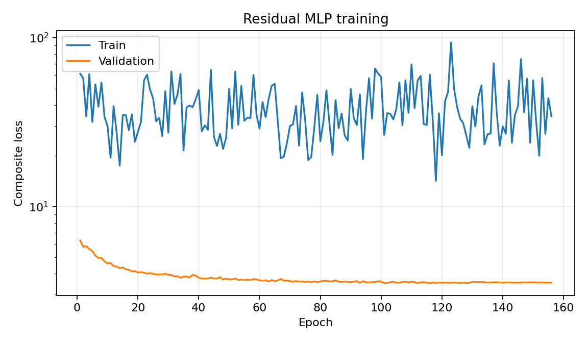
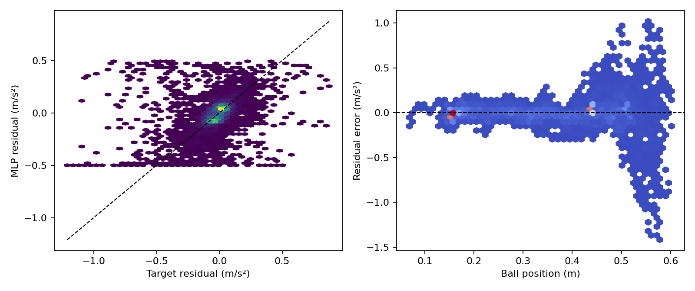
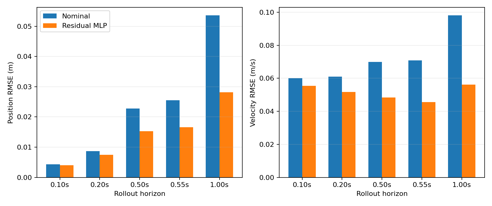
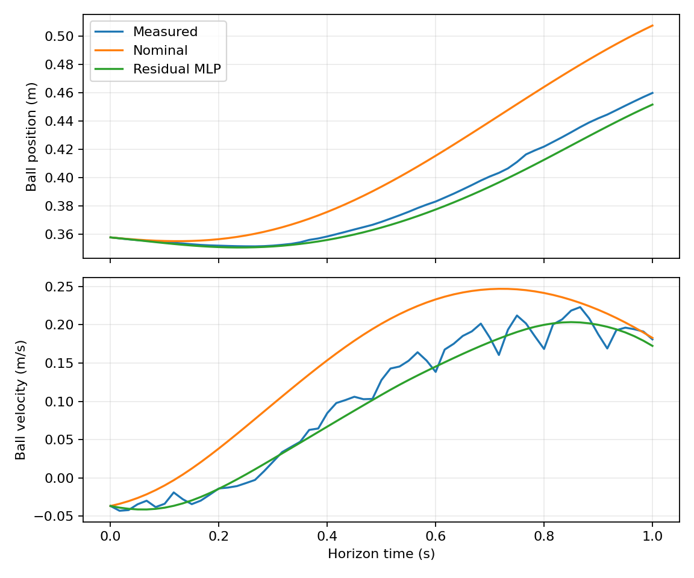

# v1.0-causal 设置下的 success-only / cap=0.5 实验

## 实验目的

本实验保留 `v1.0-causal` 的网络、causal rollout、loss、Jacobian 候选和优化超参数，
只作以下必要改变：

- 数据改为 `causal_v2_success` 的六批 success-only train/validation/test 划分；
- residual 输出限幅从 `±0.25` 改为 `±0.50 m/s²`；
- validation residual RMSE 门限从 `0.05` 放宽到 `0.15 m/s²`；
- 按用户要求，即使所有初筛候选均未通过硬门，也按 validation h33 归一化分数选择最优
  Jacobian 配置，只对 seed 7 进行一次正式训练，并继续报告 test/stress；
- 该强制选择只用于获得诊断性的最终模型，不代表模型获得实物部署资格。

原始 causal、causal v2 和 success-only cap=0.9 的配置、模型及报告均保留。

## 数据与限幅依据

数据处理、成功 trial 定义、跨 session split、SG 标签、pending-command queue 和覆盖平衡
采样与 `REPORT_CAUSAL_V2_SUCCESS.md` 相同。split 为 train/validation/test/stress =
`79/6/6/5`，训练中不含失败前缀。

cap=0.5 下的标签统计在训练前固定为：

| Split | 标签自身 RMSE | cap=0.5 bounded-oracle RMSE | `|label|>0.5` |
| --- | ---: | ---: | ---: |
| train | 0.157073 | 0.071483 | 1.306% |
| validation | 0.135121 | 0.031011 | 1.460% |

因此 `0.05 m/s²` 在 validation 上并非由限幅直接造成不可达，但既有 success-only 模型的
实际 residual RMSE 约为 `0.137 m/s²`。本实验将门限预先设为 `0.15 m/s²`：它允许比较
现有可达到的模型，同时仍限制模型不能明显差于 validation 上的 zero-residual nominal
基准 `0.1351 m/s²`。门限在查看本实验 test 结果前确定。

## 训练设置

模型与 `v1.0-causal` 完全一致：`5-16-16-1`、tanh、float64，输入为
`[pb,vb,theta,omega,a_nom]`。总 loss 为

$$
\mathcal L
=\mathcal L_{p,c}+\mathcal L_{v,c}
+0.25(\mathcal L_{p,\mathrm{SG}}+\mathcal L_{v,\mathrm{SG}})
+0.25\mathcal L_r+\lambda_J\mathcal L_J.
$$

其中 horizon/权重为 `6/12/30/33 -> 0.15/0.20/0.30/0.35`，位置和速度尺度为
`0.01 m/0.05 m/s`，$\mathcal L_r$ 为 `SmoothL1(beta=0.02)`。本实验不包含 causal v2
新增的 theta-sector、anti-damping 或 collocation loss。

初筛仍使用原来的四组 Jacobian 候选：

| 候选 | $\lambda_J$ | $L_{max}$ |
| --- | ---: | ---: |
| `jacobian_off` | 0.0 | 0.02 |
| `lmax_0p01` | 0.1 | 0.01 |
| `lmax_0p02` | 0.1 | 0.02 |
| `lmax_0p04` | 0.1 | 0.04 |

初筛使用 seed 7、16 steps/epoch、最多80 epochs；正式训练使用 seed 7、batch size 128、
32 steps/epoch、最多500 epochs、AdamW `lr=1e-3`、weight decay `1e-5`、LR patience/factor
`10/0.5`、early-stopping patience 40、gradient clipping 1.0。

候选首先按原有 hard filters 检查；若没有合格者，则按

$$
S_{33}=\left(\frac{\mathrm{RMSE}(p_b)}{0.01}\right)^2
+\left(\frac{\mathrm{RMSE}(v_b)}{0.05}\right)^2
$$

选择分数最低者。强制选择不会覆盖硬门结果，最终报告同时保留 `forced_selection`、
`export_blocked` 和各 split 的验收状态。

## 复现命令

```bash
conda run -n isaac-sim python -m residual_dynamics.cli prepare \
  --config residual_dynamics/configs/mlp_5input_causal_success_cap0p5.yaml

conda run -n isaac-sim python -m residual_dynamics.cli screen \
  --config residual_dynamics/configs/mlp_5input_causal_success_cap0p5.yaml \
  --wandb-mode disabled

conda run -n isaac-sim python -m residual_dynamics.cli report \
  --config residual_dynamics/configs/mlp_5input_causal_success_cap0p5.yaml
```

<!-- BEGIN GENERATED RESULTS -->
## 实际训练与验证结果

- Run：`mlp5_seed7_166df7ce_20260820_174327`
- 随机种子：`7`
- 最佳 epoch：`116`（停止原因：`early_stopping`）
- 训练设备：`cpu`
- CPU/GPU 基准：CUDA unavailable
- 总训练时间：356.1 s
- W&B 模式：`disabled`；Run ID：`N/A`
- W&B 链接：N/A（本地 offline run）
- 当前单模型验收：**FAIL**
- 总体验收：**FAIL**

### 逐点加速度残差

| 模型 | RMSE (m/s²) | MAE (m/s²) | Bias (m/s²) | R² |
| --- | ---: | ---: | ---: | ---: |
| 名义模型 | 0.135121 | 0.079713 | 0.015966 | -0.0142 |
| 五输入 MLP | 0.141441 | 0.077272 | 0.006629 | -0.1113 |

### 多步自由 rollout

| Horizon | 模型 | 位置 RMSE (m) | 速度 RMSE (m/s) | 位置 MSE 改善 | 速度 MSE 改善 |
| ---: | --- | ---: | ---: | ---: | ---: |
| 0.100 s | 名义模型 | 0.004310 | 0.060134 | — | — |
| 0.100 s | 五输入 MLP | 0.004040 | 0.055359 | 12.1% | 15.3% |
| 0.200 s | 名义模型 | 0.008657 | 0.061014 | — | — |
| 0.200 s | 五输入 MLP | 0.007520 | 0.051822 | 24.5% | 27.9% |
| 0.500 s | 名义模型 | 0.022756 | 0.069838 | — | — |
| 0.500 s | 五输入 MLP | 0.015333 | 0.048475 | 54.6% | 51.8% |
| 0.550 s | 名义模型 | 0.025499 | 0.070816 | — | — |
| 0.550 s | 五输入 MLP | 0.016587 | 0.045625 | 57.7% | 58.5% |
| 1.000 s | 名义模型 | 0.053559 | 0.098049 | — | — |
| 1.000 s | 五输入 MLP | 0.028168 | 0.056193 | 72.3% | 67.2% |

### SG 辅助目标与响应链诊断

| Horizon | SG目标 MLP位置 RMSE | SG目标 MLP速度 RMSE | theta RMSE / bias | vrz RMSE / bias |
| ---: | ---: | ---: | ---: | ---: |
| 0.100 s | 0.003830 | 0.035797 | 0.001496 / 0.000355 rad | 0.019209 / -0.001407 m/s |
| 0.200 s | 0.007068 | 0.038686 | 0.003526 / 0.000801 rad | 0.025145 / -0.002216 m/s |
| 0.500 s | 0.015273 | 0.035134 | 0.010150 / 0.002343 rad | 0.028717 / -0.002606 m/s |
| 0.550 s | 0.016518 | 0.035008 | 0.011202 / 0.002611 rad | 0.029096 / -0.002926 m/s |
| 1.000 s | 0.028153 | 0.045686 | 0.019613 / 0.005101 rad | 0.029143 / -0.002793 m/s |

### Jacobian 受控筛选

- 短预算候选：`jacobian_off`
- 单 seed 正式训练硬过滤：**FAIL**
- 强制择优：**YES**
- test/stress：**FAIL**
- 最终选择候选：`jacobian_off`

| 初筛候选 | 残差 RMSE | h33 pb/vb RMSE | Jacobian P99/max | 硬过滤 |
| --- | ---: | ---: | ---: | --- |
| `jacobian_off` | 0.140084 | 0.017457 / 0.047116 | 0.130159 / 0.204619 | FAIL |
| `lmax_0p01` | 0.119110 | 0.018340 / 0.048319 | 0.062317 / 0.105000 | FAIL |
| `lmax_0p02` | 0.129945 | 0.017689 / 0.047094 | 0.095851 / 0.147179 | FAIL |
| `lmax_0p04` | 0.137498 | 0.017506 / 0.047074 | 0.119323 / 0.185709 | FAIL |

| 正式复验 seed | 残差 RMSE | h33 pb/vb RMSE | Jacobian P99/max | 硬过滤 |
| ---: | ---: | ---: | ---: | --- |
| 7 | 0.141441 | 0.016587 / 0.045625 | 0.167733 / 0.321902 | FAIL |

### 独立 split 验收

| Split | trial 数 | h33 pb/vb RMSE | 验收 |
| --- | ---: | ---: | --- |
| `stress` | 5 | 0.081935 / 0.166550 | FAIL |
| `test` | 6 | 0.070609 / 0.185521 | FAIL |
| `validation` | 6 | 0.016587 / 0.045625 | FAIL |

### 分轨迹的 0.5 s rollout

| 轨迹 | 名义位置 RMSE | MLP位置 RMSE | 位置MSE改善 | 名义速度 RMSE | MLP速度 RMSE | 速度MSE改善 |
| --- | ---: | ---: | ---: | ---: | ---: | ---: |
| `constant_015` | 0.005439 | 0.004886 | 19.3% | 0.018903 | 0.015555 | 32.3% |
| `constant_035` | 0.007893 | 0.008588 | -18.4% | 0.027927 | 0.029234 | -9.6% |
| `sine_period_6` | 0.007994 | 0.008403 | -10.5% | 0.026728 | 0.026782 | -0.4% |
| `sine_period_8` | 0.025182 | 0.014434 | 67.1% | 0.080264 | 0.044366 | 69.4% |
| `trapezoid_period_8` | 0.035934 | 0.023945 | 55.6% | 0.110415 | 0.075152 | 53.7% |
| `triangle_period_8` | 0.032027 | 0.021464 | 55.1% | 0.093697 | 0.068330 | 46.8% |

### 分速度状态的逐点残差

| 速度状态 | 样本数 | 名义RMSE (m/s²) | MLP RMSE (m/s²) | MLP Bias (m/s²) |
| --- | ---: | ---: | ---: | ---: |
| `low_speed` | 3792 | 0.074894 | 0.076269 | -0.003026 |
| `negative` | 3451 | 0.162661 | 0.183896 | 0.040407 |
| `positive` | 3375 | 0.155188 | 0.147731 | -0.017063 |

### 分位置区间的逐点残差

| 位置区间 (m) | 样本数 | 名义RMSE (m/s²) | MLP RMSE (m/s²) | MLP R² |
| --- | ---: | ---: | ---: | ---: |
| `[0.000,0.100)` | 18 | 0.171339 | 0.073821 | -4.2695 |
| `[0.100,0.200)` | 3090 | 0.050291 | 0.050722 | -0.2501 |
| `[0.200,0.300)` | 1348 | 0.092372 | 0.061223 | 0.5128 |
| `[0.300,0.400)` | 1594 | 0.117061 | 0.077619 | 0.4733 |
| `[0.400,0.500]` | 3211 | 0.107346 | 0.114942 | -0.1663 |
| `[0.500,0.600)` | 1354 | 0.291107 | 0.329753 | -0.5247 |
| `[0.600,0.700)` | 3 | 0.377382 | 0.145983 | -9.6854 |

### 诊断与验收

- 验证样本 OOD 比例：0.00%
- 残差输出饱和比例：1.055%
- 静止段总预测加速度中位数：0.034230 m/s²
- 物理状态无量纲 Jacobian范数 P99：0.1677
- Rollout 状态 OOD 比例：0.07%
- 物理 Jacobian 范数 P50/P95/P99/max：0.042389 / 0.096225 / 0.167733 / 0.321902 m/s²
- 相邻预测状态残差变化 P95/P99/max：0.029245 / 0.053658 / 0.223259 m/s²
- 命令队列对齐 RMSE/max：0.000e+00 / 0.000e+00 m/s
- 响应链系统偏差：检测到，禁止进入实物测试
- theta 总增益比例 min/P1/P99/max：-0.1301 / 0.4175 / 1.9603 / 3.4246
- anti-damping P99/max：0.2761 / 0.7260 s⁻¹

| 验收项 | 结果 |
| --- | --- |
| `all_dynamic_groups_no_large_degradation` | PASS |
| `command_queue_alignment` | PASS |
| `finite_outputs_and_gradients` | PASS |
| `h33_position_improvement` | PASS |
| `h33_velocity_improvement` | PASS |
| `jacobian_max_within_limit` | FAIL |
| `jacobian_p99_within_limit` | FAIL |
| `residual_rmse` | PASS |
| `residual_saturation` | FAIL |
| `response_chain_no_systematic_bias` | FAIL |
| `static_total_acceleration` | FAIL |

### 结果图









> 注意：同一验证集用于 early stopping 和最终离线评价，以上结果不是独立测试集上的无偏泛化估计。
<!-- END GENERATED RESULTS -->
