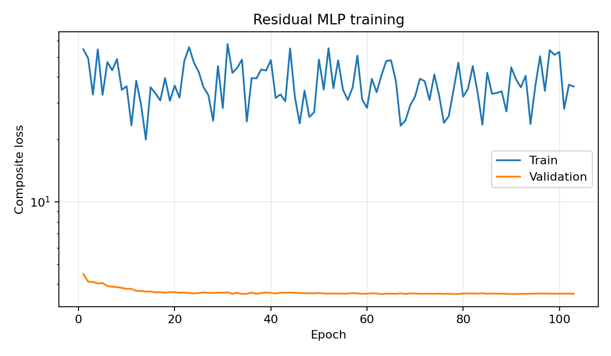
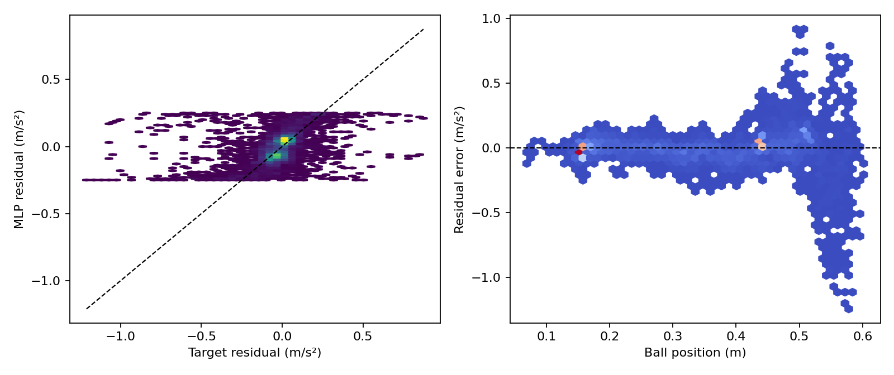
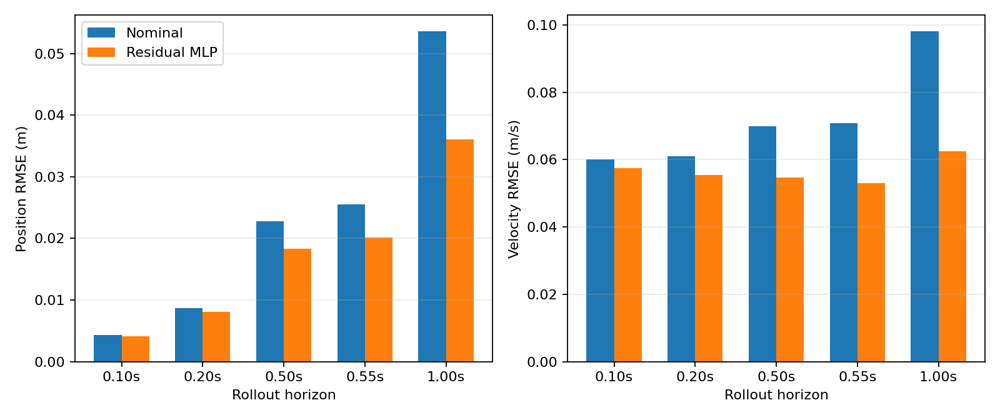
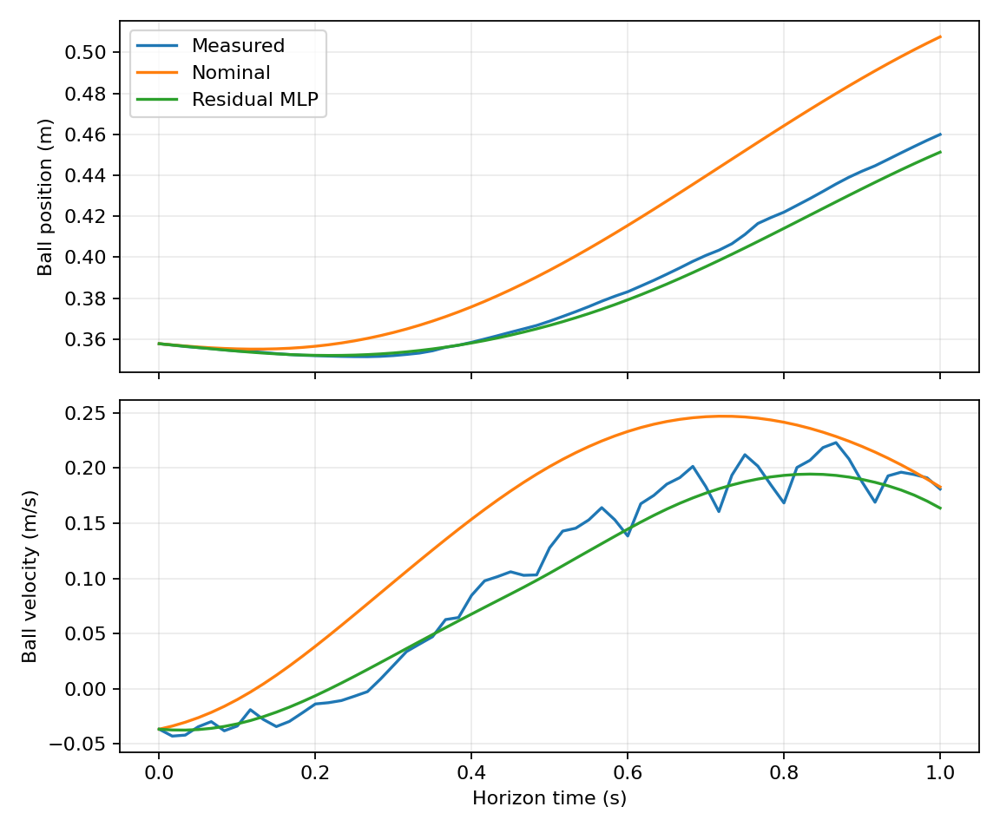

# success-only causal 模型：短期与逐点损失重平衡

## 实验目标

本实验检验原始 `v1.0-causal` 损失过度偏向远期 rollout 是否导致逐点加速度拟合、
局部平滑性和输出饱和率恶化。训练直接使用 `causal_v2_success` 的成功 trial，固定
`seed=7` 和 `cap=0.25 m/s²`，不进行短预算候选筛选或多种子选择。

相对于 `causal_v2_success cap=0.25` 原损失模型，本实验改变两项训练因素：

1. rollout horizon 权重由 `0.15/0.20/0.30/0.35` 改为
   `0.40/0.30/0.20/0.10`；
2. 逐点 residual 权重由 `0.25` 提高到 `5.0`，并启用
   `weight=0.1, L_max=0.04 m/s²` 的 causal Jacobian 正则。

因此，本实验可以判断“整体损失重平衡”是否有效，但不能把最终变化严格归因于 horizon
权重、point 权重或 Jacobian 中的某一个因素。

## 数据处理

- 数据来源：`20260815`、`20260817`、`20260818`、`20260819_01/02/03` 六批实物日志。
- 监督训练只使用 `tracking_duration` 成功 trial；失败 trial 不进入 train、validation 或
  test，固定的五条失败安全前缀只作为独立 stress test。
- split 沿用 `causal_v2_success`：79 条 train、6 条 validation、6 条 test、5 条 stress；
  每个 validation/test 都包含六个日期来源。
- 训练 sampler 保持 50% empirical stream 与 50% position/speed/session/group coverage
  stream；位置覆盖固定为 `[0,0.1),...,[0.6,0.7]` 七档。
- SG 滤波、edge trim、gap/queue reset 分段、pending-command queue 重建及响应模型均不变。
- 输入归一化、状态 scale 和 OOD 统计仅由 train split 计算；test/stress 不参与 checkpoint
  或超参数选择。

在 `cap=0.25` 下，将标签投影到可表示区间得到的 residual RMSE 理论下界为：train
`0.093998`、validation `0.061740`、test `0.155219`、stress `0.299599 m/s²`。因此
`0.15 m/s²` 只作为连续性验收门限；特别是 test 的该门限在理论上略不可达。

## 模型与训练目标

模型保持 `5-16-16-1`、tanh、float64，输入为
`[pb, vb, theta, omega, a_nom]`，输出通过 tanh 限幅到 `±0.25 m/s²`。

训练损失为：

$$
\mathcal L=
\sum_{H\in\{6,12,30,33\}}w_H
\left(\mathcal L_{p,c,H}+\mathcal L_{v,c,H}
+0.25\mathcal L_{p,\mathrm{SG},H}
+0.25\mathcal L_{v,\mathrm{SG},H}\right)
+5.0\mathcal L_r+0.1\mathcal L_J,
$$

其中：

- $w_6,w_{12},w_{30},w_{33}=0.40,0.30,0.20,0.10$；
- rollout 位置和速度分别以 `0.01 m`、`0.05 m/s` 归一化；
- $\mathcal L_r$ 为 `SmoothL1(beta=0.02 m/s²)`；
- $\mathcal L_J=\operatorname{mean}[\operatorname{ReLU}(\|J_rS_x\|_2/L_{max}-1)^2]$；
- $L_{max}=0.04\,\mathrm{m/s^2}$，$S_x$ 使用 train split 的物理状态 scale；
- Jacobian 在 causal rollout endpoint 和 RK4 stages 上计算，并保留二阶梯度；
- v2 control-channel sector、anti-damping 和 collocation loss 均关闭。

为避免只根据名义权重判断优化重心，训练 history 和最终报告额外记录每个 horizon 的实际
加权贡献，以及 rollout、point、Jacobian 对总 validation loss 的实际占比。

## 优化器和 checkpoint 选择

| 配置 | 数值 |
| --- | ---: |
| seed | 7 |
| batch size | 128 |
| steps/epoch | 32 |
| max epochs | 500 |
| optimizer | AdamW |
| learning rate | 0.001 |
| weight decay | 0.00001 |
| LR patience/factor | 10 / 0.5 |
| early-stopping patience | 40 |
| gradient clipping | 1.0 |
| validation max windows | 2048 |

只执行一次完整训练，以完整 validation loss 的最低值选择 checkpoint；checkpoint 固定后
才运行 test 和 stress，不根据 holdout 结果修改设置。

## 复现命令

```bash
conda run -n isaac-sim python -m residual_dynamics.cli prepare \
  --config residual_dynamics/configs/mlp_5input_causal_success_rebalanced.yaml

conda run -n isaac-sim python -m residual_dynamics.cli train \
  --config residual_dynamics/configs/mlp_5input_causal_success_rebalanced.yaml \
  --wandb-mode disabled

conda run -n isaac-sim python -m residual_dynamics.cli evaluate \
  --config residual_dynamics/configs/mlp_5input_causal_success_rebalanced.yaml

conda run -n isaac-sim python -m residual_dynamics.cli report \
  --config residual_dynamics/configs/mlp_5input_causal_success_rebalanced.yaml
```

<!-- BEGIN GENERATED RESULTS -->
## 实际训练与验证结果

- Run：`mlp5_seed7_979948b2_20260820_195029`
- 随机种子：`7`
- 最佳 epoch：`63`（停止原因：`early_stopping`）
- 训练设备：`cpu`
- CPU/GPU 基准：CUDA unavailable
- 总训练时间：309.9 s
- W&B 模式：`disabled`；Run ID：`N/A`
- W&B 链接：N/A（本地 offline run）
- 当前单模型验收：**FAIL**
- 总体验收：**FAIL**

### 最佳 checkpoint 的 validation loss 构成

| 加权项 | 数值 | 占总 loss |
| --- | ---: | ---: |
| Rollout | 3.248496 | 90.65% |
| 逐点 residual | 0.325532 | 9.08% |
| Jacobian | 0.009594 | 0.27% |
| 控制通道 | 0.000000 | 0.00% |
| **总计** | **3.583621** | **100.00%** |

| Rollout horizon | 加权贡献 | 占 rollout loss | 占总 loss |
| ---: | ---: | ---: | ---: |
| h6 | 0.660971 | 20.35% | 18.44% |
| h12 | 0.652167 | 20.08% | 18.20% |
| h30 | 1.232103 | 37.93% | 34.38% |
| h33 | 0.703254 | 21.65% | 19.62% |

### 逐点加速度残差

| 模型 | RMSE (m/s²) | MAE (m/s²) | Bias (m/s²) | R² |
| --- | ---: | ---: | ---: | ---: |
| 名义模型 | 0.135121 | 0.079713 | 0.015966 | -0.0142 |
| 五输入 MLP | 0.127629 | 0.073854 | 0.006866 | 0.0952 |

### 多步自由 rollout

| Horizon | 模型 | 位置 RMSE (m) | 速度 RMSE (m/s) | 位置 MSE 改善 | 速度 MSE 改善 |
| ---: | --- | ---: | ---: | ---: | ---: |
| 0.100 s | 名义模型 | 0.004310 | 0.060134 | — | — |
| 0.100 s | 五输入 MLP | 0.004170 | 0.057506 | 6.4% | 8.6% |
| 0.200 s | 名义模型 | 0.008657 | 0.061014 | — | — |
| 0.200 s | 五输入 MLP | 0.008041 | 0.055534 | 13.7% | 17.2% |
| 0.500 s | 名义模型 | 0.022756 | 0.069838 | — | — |
| 0.500 s | 五输入 MLP | 0.018362 | 0.054734 | 34.9% | 38.6% |
| 0.550 s | 名义模型 | 0.025499 | 0.070816 | — | — |
| 0.550 s | 五输入 MLP | 0.020144 | 0.053086 | 37.6% | 43.8% |
| 1.000 s | 名义模型 | 0.053559 | 0.098049 | — | — |
| 1.000 s | 五输入 MLP | 0.036018 | 0.062541 | 54.8% | 59.3% |

### SG 辅助目标与响应链诊断

| Horizon | SG目标 MLP位置 RMSE | SG目标 MLP速度 RMSE | theta RMSE / bias | vrz RMSE / bias |
| ---: | ---: | ---: | ---: | ---: |
| 0.100 s | 0.003972 | 0.038397 | 0.001496 / 0.000355 rad | 0.019209 / -0.001407 m/s |
| 0.200 s | 0.007605 | 0.043522 | 0.003526 / 0.000801 rad | 0.025145 / -0.002216 m/s |
| 0.500 s | 0.018313 | 0.043488 | 0.010150 / 0.002343 rad | 0.028717 / -0.002606 m/s |
| 0.550 s | 0.020086 | 0.043670 | 0.011202 / 0.002611 rad | 0.029096 / -0.002926 m/s |
| 1.000 s | 0.036011 | 0.052918 | 0.019613 / 0.005101 rad | 0.029143 / -0.002793 m/s |

### 独立 split 验收

| Split | trial 数 | h33 pb/vb RMSE | 验收 |
| --- | ---: | ---: | --- |
| `stress` | 5 | 0.086874 / 0.180569 | FAIL |
| `test` | 6 | 0.072081 / 0.189126 | FAIL |
| `validation` | 6 | 0.020144 / 0.053086 | FAIL |

### 分轨迹的 0.5 s rollout

| 轨迹 | 名义位置 RMSE | MLP位置 RMSE | 位置MSE改善 | 名义速度 RMSE | MLP速度 RMSE | 速度MSE改善 |
| --- | ---: | ---: | ---: | ---: | ---: | ---: |
| `constant_015` | 0.005439 | 0.004997 | 15.6% | 0.018903 | 0.016323 | 25.4% |
| `constant_035` | 0.007893 | 0.009485 | -44.4% | 0.027927 | 0.032773 | -37.7% |
| `sine_period_6` | 0.007994 | 0.008279 | -7.3% | 0.026728 | 0.027613 | -6.7% |
| `sine_period_8` | 0.025182 | 0.019543 | 39.8% | 0.080264 | 0.058224 | 47.4% |
| `trapezoid_period_8` | 0.035934 | 0.028280 | 38.1% | 0.110415 | 0.084277 | 41.7% |
| `triangle_period_8` | 0.032027 | 0.025647 | 35.9% | 0.093697 | 0.073342 | 38.7% |

### 分速度状态的逐点残差

| 速度状态 | 样本数 | 名义RMSE (m/s²) | MLP RMSE (m/s²) | MLP Bias (m/s²) |
| --- | ---: | ---: | ---: | ---: |
| `low_speed` | 3792 | 0.074894 | 0.077310 | -0.008688 |
| `negative` | 3451 | 0.162661 | 0.160353 | 0.036491 |
| `positive` | 3375 | 0.155188 | 0.135055 | -0.005951 |

### 分位置区间的逐点残差

| 位置区间 (m) | 样本数 | 名义RMSE (m/s²) | MLP RMSE (m/s²) | MLP R² |
| --- | ---: | ---: | ---: | ---: |
| `[0.000,0.100)` | 18 | 0.171339 | 0.053007 | -1.7169 |
| `[0.100,0.200)` | 3090 | 0.050291 | 0.050267 | -0.2278 |
| `[0.200,0.300)` | 1348 | 0.092372 | 0.059007 | 0.5474 |
| `[0.300,0.400)` | 1594 | 0.117061 | 0.083854 | 0.3853 |
| `[0.400,0.500]` | 3211 | 0.107346 | 0.105038 | 0.0261 |
| `[0.500,0.600)` | 1354 | 0.291107 | 0.289782 | -0.1774 |
| `[0.600,0.700)` | 3 | 0.377382 | 0.155314 | -11.0951 |

### 诊断与验收

- 验证样本 OOD 比例：0.00%
- 残差输出饱和比例：2.458%
- 静止段总预测加速度中位数：0.033115 m/s²
- 物理状态无量纲 Jacobian范数 P99：0.0978
- Rollout 状态 OOD 比例：0.11%
- 物理 Jacobian 范数 P50/P95/P99/max：0.038032 / 0.068176 / 0.097774 / 0.153613 m/s²
- 相邻预测状态残差变化 P95/P99/max：0.020601 / 0.042243 / 0.107754 m/s²
- 命令队列对齐 RMSE/max：0.000e+00 / 0.000e+00 m/s
- 响应链系统偏差：检测到，禁止进入实物测试
- theta 总增益比例 min/P1/P99/max：-0.4502 / 0.1925 / 1.6746 / 2.6342
- anti-damping P99/max：0.5258 / 0.8341 s⁻¹

| 验收项 | 结果 |
| --- | --- |
| `all_dynamic_groups_no_large_degradation` | PASS |
| `command_queue_alignment` | PASS |
| `finite_outputs_and_gradients` | PASS |
| `h33_position_improvement` | PASS |
| `h33_velocity_improvement` | PASS |
| `jacobian_max_within_limit` | FAIL |
| `jacobian_p99_within_limit` | FAIL |
| `residual_rmse` | PASS |
| `residual_saturation` | FAIL |
| `response_chain_no_systematic_bias` | FAIL |
| `static_total_acceleration` | FAIL |

### 结果图









> 注意：validation 用于 early stopping；test/stress 在 checkpoint 固定后才运行，未参与模型选择。
<!-- END GENERATED RESULTS -->

<!-- BEGIN COMPARISON -->
## 产物与完整性

- Run：`mlp5_seed7_979948b2_20260820_195029`
- 数据集 hash：`567520f960491f3537addab68c341a6e94b823e57c7c6d929b461fde2374b6b9`
- 配置 hash：`979948b208759ca49f1635b83489fe6918cd9041fe3c611f125140cb0e2b2e15`
- checkpoint SHA-256：`77b1e04aaddf4f1b2460db977d0605c5b23a27898b5658091fa855fc3acec4df`
- portable weights SHA-256：`b99e103bda15118aa5b25d2bcbe38bfecd5907648fd6a61a55722b6f6e6dea6d`
- 最佳 checkpoint：epoch 63；共训练 103 epochs，early stopping；耗时 309.9 s。
- 完整分 session、group、position bin、speed regime 和 complete/failure-prefix 指标保存在
  `results_causal_success_rebalanced/summary.json`，逐项扁平指标保存在 `metrics.csv`。

## 与已有模型的统一离线对比

下表中的 `cap=0.25 原损失` 和 `cap=0.5 原损失` 与本模型使用相同 success-only 数据、
split、sampler 和 seed 7。0815-only 模型是在同一 multi-success split 上重新评价的既有
seed 27、`Lmax=0.04` 模型，因此可反映跨日期泛化差异，但不是严格的单变量对照。

| Split | 模型 | point RMSE | h33 pb/vb RMSE | Jacobian P99/max | 相对饱和率 | static total acc median |
| --- | --- | ---: | ---: | ---: | ---: | ---: |
| validation | **本模型** | 0.127629 | 0.020144 / 0.053086 | 0.097774 / 0.153613 | 2.458% | 0.033115 |
| validation | cap=0.25 原损失 | 0.128538 | **0.019432 / 0.051171** | 0.121078 / 0.255182 | 4.153% | **0.032651** |
| validation | cap=0.5 原损失 | 0.141441 | 0.016587 / 0.045625 | 0.167733 / 0.321902 | 1.055% | 0.034230 |
| validation | 0815-only cap=0.25 | **0.117949** | 0.021372 / 0.055370 | **0.047867 / 0.052449** | **0.047%** | — |
| test | **本模型** | **0.192937** | 0.072081 / 0.189126 | 0.097580 / 0.147188 | 2.712% | **0.032050** |
| test | cap=0.25 原损失 | 0.195049 | 0.072000 / 0.189123 | 0.116974 / 0.247501 | 3.739% | 0.040640 |
| test | cap=0.5 原损失 | 0.202425 | **0.070609 / 0.185521** | 0.143386 / 0.306613 | **1.629%** | 0.048191 |
| test | 0815-only cap=0.25 | 0.193449 | 0.072622 / 0.190946 | **0.045911 / 0.051986** | **0.226%** | — |
| stress | **本模型** | 0.427394 | 0.086874 / 0.180569 | 0.126860 / 0.153757 | 18.939% | **0.234650** |
| stress | cap=0.25 原损失 | 0.431896 | 0.086387 / 0.178662 | 0.167814 / 0.261460 | 28.490% | 0.261741 |
| stress | cap=0.5 原损失 | 0.461167 | **0.081935 / 0.166550** | 0.228701 / 0.334304 | **12.286%** | 0.392999 |
| stress | 0815-only cap=0.25 | **0.415975** | 0.089653 / 0.187556 | **0.048796 / 0.053441** | **0.898%** | — |

### 相对于同 cap 原损失的变化

与最严格的同数据、同 seed、同 cap 对照相比：

- point RMSE 在 validation/test/stress 分别降低约 `0.7%/1.1%/1.0%`；
- Jacobian P99 分别降低约 `19.2%/16.6%/24.4%`，Jacobian max 分别降低约
  `39.8%/40.5%/41.2%`；
- 相对饱和率分别降低约 `40.8%/27.5%/33.5%`；
- h33 pb/vb RMSE 在 validation 增加约 `3.7%/3.7%`，test 基本不变，stress 增加约
  `0.6%/1.1%`。

这说明重平衡实现了预期的 Pareto 移动：逐点拟合、局部平滑性和撞限情况改善，代价是
少量远期 rollout 精度。变化在 test/stress 上保持同一方向，因而不是只对 validation
early stopping 集合的偶然拟合。

### 实际 loss 分配

最佳 checkpoint 的 validation loss 中，rollout、point 和 Jacobian 实际占比为
`90.65%/9.08%/0.27%`。旧 cap=0.25 模型的 point 项只约占 `0.34%`，因此
`point_weight=5.0` 已将逐点监督提高约一个数量级，但 rollout 仍然是主目标。

虽然名义 horizon 权重随预测距离单调下降，实际 rollout 贡献为：

| Horizon | 名义权重 | 实际占 rollout | 实际占总 loss |
| ---: | ---: | ---: | ---: |
| h6 | 0.40 | 20.35% | 18.44% |
| h12 | 0.30 | 20.08% | 18.20% |
| h30 | 0.20 | 37.93% | 34.38% |
| h33 | 0.10 | 21.65% | 19.62% |

h30 仍是最大项，原因是其未加权原始累计状态误差远大于 h6/h12。与旧 cap=0.25 模型
约 `6.2%/10.3%/36.1%/47.4%` 的分配相比，h33 不再单独支配训练，而 h6/h12 的总占比
由约 16.5% 提高到 40.4%。这比简单观察配置权重更准确地描述了新模型的优化重心。

### 硬指标结论

本模型没有通过完整验收：

- validation Jacobian P99/max 为 `0.097774/0.153613 m/s²`，仍超过
  `0.05/0.08 m/s²` gate；
- validation 相对饱和率为 `2.458%`，高于 `1%`；
- validation static total acceleration median 为 `0.033115 m/s²`，高于
  `0.02 m/s²`；
- validation response-chain bias 仍失败；该响应链指标在各 residual 模型间基本不变，
  不能由本次 residual loss 重加权解决；
- test 的 h33 pb/vb 虽分别改善 `7.5%/10.4%`，但未达到当前 `30%` 改善门限；test
  point RMSE `0.192937 m/s²` 也必然高于 `0.15`，因为 cap=0.25 的 test oracle floor
  已是 `0.155219 m/s²`；
- stress rollout 保持有限且没有比 nominal 恶化超过 10%，但相对饱和率仍为 18.939%。

因此，该 checkpoint 和 portable weights 作为本轮固定 seed 的最终诊断模型保留，但
`eligible_for_real_world_test=false`，不导出为部署模型。由于本轮按约定只训练一个 seed，
上述结论也不代表已经验证随机种子稳定性。
<!-- END COMPARISON -->
