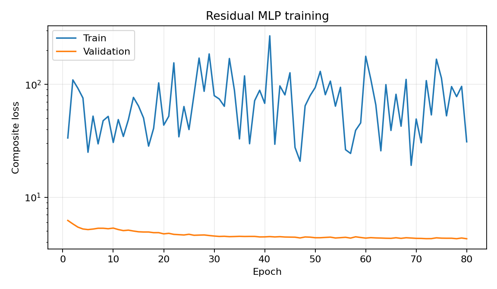
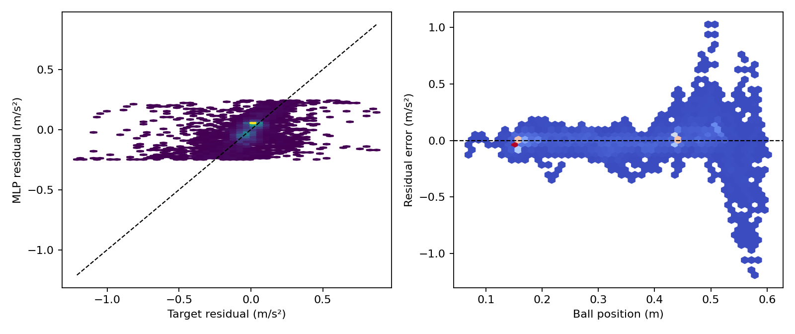
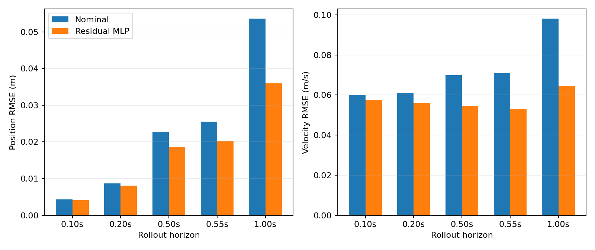
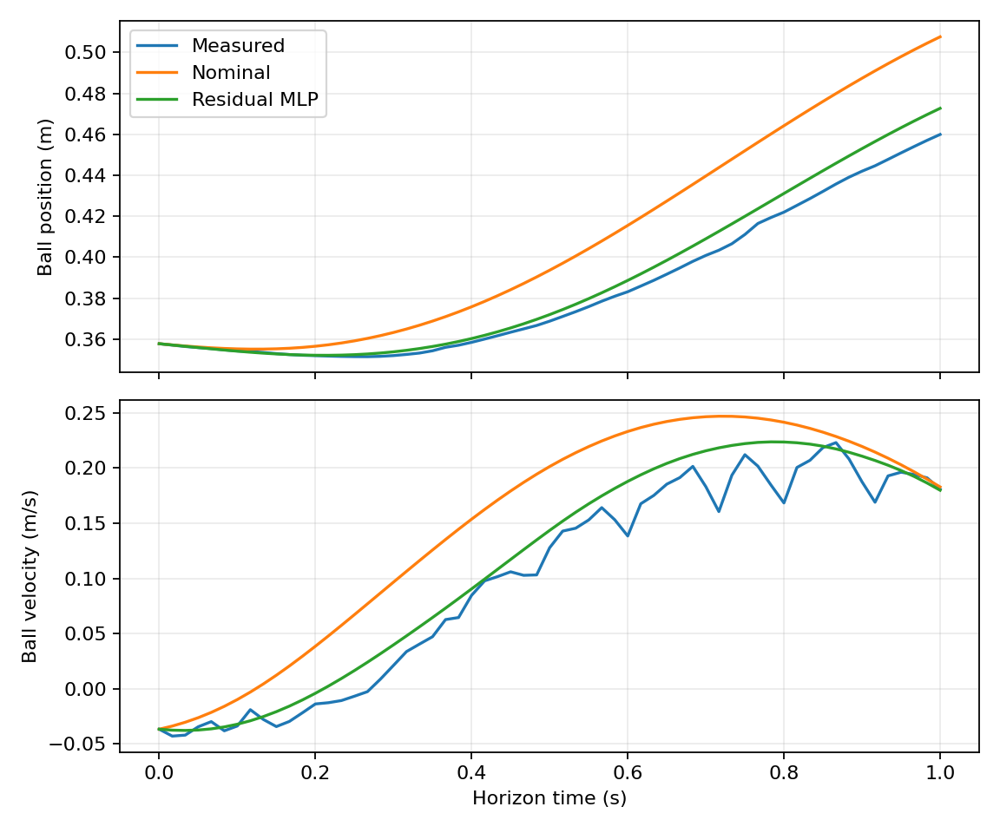

# v1_causal_v2 多批次与控制通道约束残差模型

本报告对应 `configs/mlp_5input_causal_v2.yaml`。模型保持
`[pb,vb,theta,omega,a_nom] -> 5-16-16-1`、tanh、float64 和
`±0.25 m/s²` 输出限幅不变。

## 数据与划分契约

- 数据源为 20260815、17、18 和 20260819_01/02/03 六个 session；
- manifest schema 为 version 3，trial 唯一键为 `session/group/trial_directory`；
- validation/test 各从每个 session 固定留出一条成功 trial；
- 五条 solver-fallback 安全前缀仅用于 stress；其余有效失败前缀进入 train；
- 归一化、位置覆盖门槛、分位数和 Mahalanobis OOD 统计只使用 train；
- test/stress 只在 λθ 和 seed 已由 validation 选定后运行。

位置分层固定为 `[0.0,0.1)` 到 `[0.6,0.7]` 七档，训练 batch 由 50%
原始经验流和 50% position/speed/session/group 覆盖流组成。

## 控制通道约束

训练对真实 rollout endpoint、RK4 stage 和 25% deterministic
Latin-hypercube collocation 点计算总加速度关于状态的端到端导数。约束包括：

- 当 `|∂a_nom/∂theta| >= 1` 时，将总梁角增益比例软限制在 `[0.8,1.2]`；
- 将 `∂(a_nom+r)/∂vb` 超过 `0.2 s⁻¹` 的部分作为 anti-damping 惩罚；
- 保留原物理状态 Jacobian 平滑正则；
- 导出前在 4096 点 outer safety set 上对 scale=1、联合 OOD 衰减后的 residual
  重新执行 hard gate；
- 在 H={6,12,33} 上比较 residual 与 nominal 的命令—状态灵敏度。

筛选顺序为 λθ={0,1,10} 的 seed-7 小预算，必要时追加 λθ=30；`channel_off`
不得导出。合格设置使用 seed={7,17,27} 正式训练，三个 seed 均须通过 validation，
随后才执行一次 test/stress。任一 hard gate 失败均不导出模型或生成 v2 solver。

## 复现命令

```bash
conda run -n isaac-sim python -m residual_dynamics.cli prepare \
  --config residual_dynamics/configs/mlp_5input_causal_v2.yaml

conda run -n isaac-sim python -m residual_dynamics.cli screen \
  --config residual_dynamics/configs/mlp_5input_causal_v2.yaml
```

<!-- BEGIN GENERATED RESULTS -->
## 实际训练与验证结果

- Run：`mlp5_seed7_dfc800ea_20260820_161342`
- 随机种子：`7`
- 最佳 epoch：`80`（停止原因：`max_epochs`）
- 训练设备：`cpu`
- CPU/GPU 基准：CUDA unavailable
- 总训练时间：125.4 s
- W&B 模式：`disabled`；Run ID：`N/A`
- W&B 链接：N/A（本地 offline run）
- 当前单模型验收：**FAIL**
- 总体验收：**FAIL**

### 逐点加速度残差

| 模型 | RMSE (m/s²) | MAE (m/s²) | Bias (m/s²) | R² |
| --- | ---: | ---: | ---: | ---: |
| 名义模型 | 0.135121 | 0.079713 | 0.015966 | -0.0142 |
| 五输入 MLP | 0.122484 | 0.070178 | 0.004346 | 0.1667 |

### 多步自由 rollout

| Horizon | 模型 | 位置 RMSE (m) | 速度 RMSE (m/s) | 位置 MSE 改善 | 速度 MSE 改善 |
| ---: | --- | ---: | ---: | ---: | ---: |
| 0.100 s | 名义模型 | 0.004310 | 0.060134 | — | — |
| 0.100 s | 五输入 MLP | 0.004181 | 0.057731 | 5.9% | 7.8% |
| 0.200 s | 名义模型 | 0.008657 | 0.061014 | — | — |
| 0.200 s | 五输入 MLP | 0.008076 | 0.055938 | 13.0% | 15.9% |
| 0.500 s | 名义模型 | 0.022756 | 0.069838 | — | — |
| 0.500 s | 五输入 MLP | 0.018499 | 0.054586 | 33.9% | 38.9% |
| 0.550 s | 名义模型 | 0.025499 | 0.070816 | — | — |
| 0.550 s | 五输入 MLP | 0.020283 | 0.053024 | 36.7% | 43.9% |
| 1.000 s | 名义模型 | 0.053559 | 0.098049 | — | — |
| 1.000 s | 五输入 MLP | 0.035983 | 0.064422 | 54.9% | 56.8% |

### SG 辅助目标与响应链诊断

| Horizon | SG目标 MLP位置 RMSE | SG目标 MLP速度 RMSE | theta RMSE / bias | vrz RMSE / bias |
| ---: | ---: | ---: | ---: | ---: |
| 0.100 s | 0.003984 | 0.038535 | 0.001496 / 0.000355 rad | 0.019209 / -0.001407 m/s |
| 0.200 s | 0.007640 | 0.043745 | 0.003526 / 0.000801 rad | 0.025145 / -0.002216 m/s |
| 0.500 s | 0.018455 | 0.043256 | 0.010150 / 0.002343 rad | 0.028717 / -0.002606 m/s |
| 0.550 s | 0.020233 | 0.043381 | 0.011202 / 0.002611 rad | 0.029096 / -0.002926 m/s |
| 1.000 s | 0.035980 | 0.055020 | 0.019613 / 0.005101 rad | 0.029143 / -0.002793 m/s |

### 控制通道约束筛选

- 短预算候选：`无`
- 三 seed 稳定性：**FAIL**
- test/stress：**FAIL/未运行**
- 最终可导出候选：`无`

| 候选 | λθ | 残差 RMSE | h33 pb/vb RMSE | ρ P1/P99 | gv P99/max | 硬过滤 |
| --- | ---: | ---: | ---: | ---: | ---: | --- |
| `channel_off` | 0.0 | 0.124390 | 0.020245 / 0.053041 | 0.5747 / 1.0450 | -0.0327 / 0.0413 | FAIL |
| `channel_1` | 1.0 | 0.121765 | 0.020266 / 0.052913 | 0.6227 / 1.0138 | 0.1007 / 0.2177 | FAIL |
| `channel_10` | 10.0 | 0.122164 | 0.020269 / 0.052965 | 0.7343 / 1.0082 | 0.0928 / 0.2147 | FAIL |
| `channel_30` | 30.0 | 0.122484 | 0.020283 / 0.053024 | 0.7716 / 1.0071 | 0.0858 / 0.2045 | FAIL |

### 独立 split 验收

| Split | trial 数 | h33 pb/vb RMSE | 验收 |
| --- | ---: | ---: | --- |
| `validation` | 6 | 0.020283 / 0.053024 | FAIL |

### 分轨迹的 0.5 s rollout

| 轨迹 | 名义位置 RMSE | MLP位置 RMSE | 位置MSE改善 | 名义速度 RMSE | MLP速度 RMSE | 速度MSE改善 |
| --- | ---: | ---: | ---: | ---: | ---: | ---: |
| `constant_015` | 0.005439 | 0.005260 | 6.5% | 0.018903 | 0.016458 | 24.2% |
| `constant_035` | 0.007893 | 0.008481 | -15.5% | 0.027927 | 0.028761 | -6.1% |
| `sine_period_6` | 0.007994 | 0.006088 | 42.0% | 0.026728 | 0.020517 | 41.1% |
| `sine_period_8` | 0.025182 | 0.019783 | 38.3% | 0.080264 | 0.059038 | 45.9% |
| `trapezoid_period_8` | 0.035934 | 0.028816 | 35.7% | 0.110415 | 0.084899 | 40.9% |
| `triangle_period_8` | 0.032027 | 0.026360 | 32.3% | 0.093697 | 0.075269 | 35.5% |

### 分速度状态的逐点残差

| 速度状态 | 样本数 | 名义RMSE (m/s²) | MLP RMSE (m/s²) | MLP Bias (m/s²) |
| --- | ---: | ---: | ---: | ---: |
| `low_speed` | 3792 | 0.074894 | 0.073848 | 0.003052 |
| `negative` | 3451 | 0.162661 | 0.147895 | 0.016582 |
| `positive` | 3375 | 0.155188 | 0.136768 | -0.006712 |

### 分位置区间的逐点残差

| 位置区间 (m) | 样本数 | 名义RMSE (m/s²) | MLP RMSE (m/s²) | MLP R² |
| --- | ---: | ---: | ---: | ---: |
| `[0.000,0.100)` | 18 | 0.171339 | 0.041232 | -0.6439 |
| `[0.100,0.200)` | 3090 | 0.050291 | 0.046879 | -0.0679 |
| `[0.200,0.300)` | 1348 | 0.092372 | 0.065901 | 0.4355 |
| `[0.300,0.400)` | 1594 | 0.117061 | 0.079273 | 0.4507 |
| `[0.400,0.500]` | 3211 | 0.107346 | 0.106047 | 0.0073 |
| `[0.500,0.600)` | 1354 | 0.291107 | 0.272292 | -0.0396 |
| `[0.600,0.700)` | 3 | 0.377382 | 0.184424 | -16.0539 |

### 诊断与验收

- 验证样本 OOD 比例：0.41%
- 残差输出饱和比例：0.932%
- 静止段总预测加速度中位数：0.034256 m/s²
- 物理状态无量纲 Jacobian范数 P99：0.0701
- Rollout 状态 OOD 比例：0.39%
- 物理 Jacobian 范数 P50/P95/P99/max：0.033577 / 0.055678 / 0.070125 / 0.113014 m/s²
- 相邻预测状态残差变化 P95/P99/max：0.015869 / 0.031510 / 0.071555 m/s²
- 命令队列对齐 RMSE/max：0.000e+00 / 0.000e+00 m/s
- 响应链系统偏差：检测到，禁止进入实物测试
- theta 总增益比例 min/P1/P99/max：0.6817 / 0.7716 / 1.0071 / 1.0487
- anti-damping P99/max：0.0858 / 0.2045 s⁻¹

| 验收项 | 结果 |
| --- | --- |
| `all_dynamic_groups_no_large_degradation` | PASS |
| `anti_damping` | PASS |
| `command_queue_alignment` | PASS |
| `control_sensitivity` | FAIL |
| `finite_outputs_and_gradients` | PASS |
| `h33_position_improvement` | PASS |
| `h33_velocity_improvement` | PASS |
| `jacobian_max_within_limit` | FAIL |
| `jacobian_p99_within_limit` | FAIL |
| `outer_anti_damping` | PASS |
| `outer_safety_set_finite` | PASS |
| `outer_theta_sector` | FAIL |
| `residual_rmse` | FAIL |
| `residual_saturation` | PASS |
| `response_chain_no_systematic_bias` | FAIL |
| `static_total_acceleration` | FAIL |
| `theta_sector` | FAIL |

### 结果图









> 注意：同一验证集用于 early stopping 和最终离线评价，以上结果不是独立测试集上的无偏泛化估计。
<!-- END GENERATED RESULTS -->
