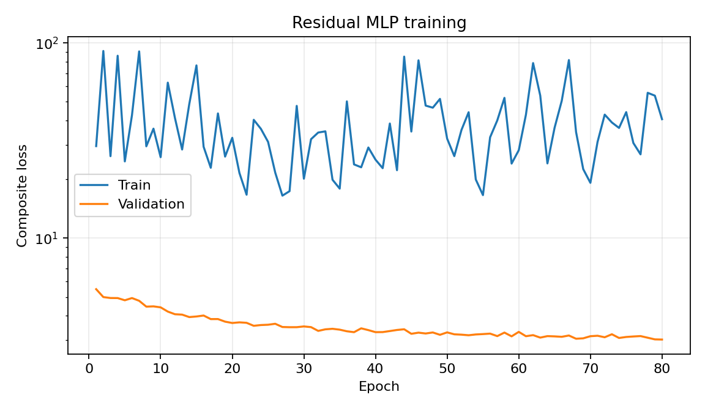
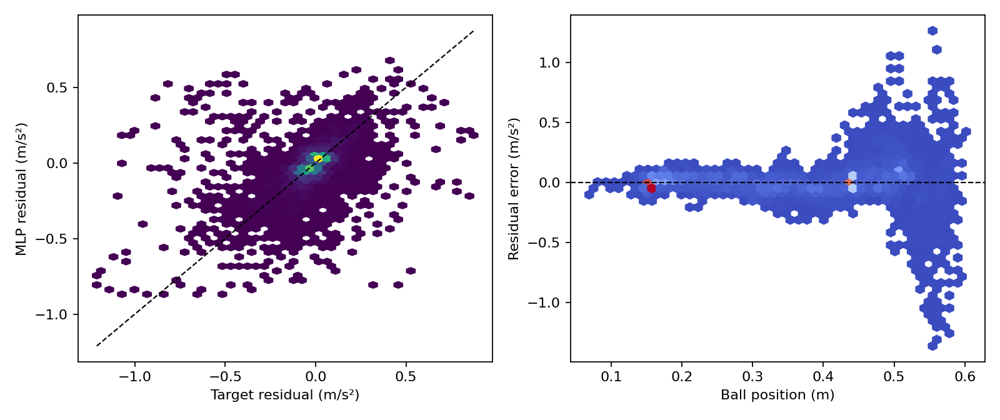
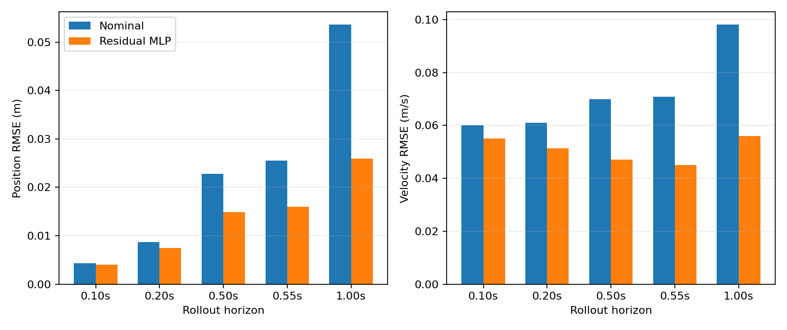
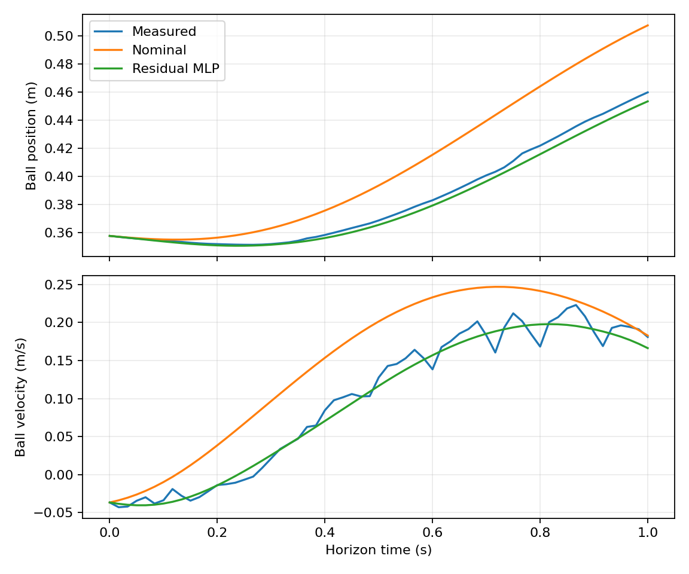

# v1_causal_v2 success-only 残差加速度模型

本报告记录 success-only 数据变体的处理规则、输出限幅选择、训练设计和离线验证结果。
原始 `v1_causal_v2` 数据、配置、checkpoint 和报告均保留，本实验使用独立目录。

## 数据处理方式

数据源仍为 20260815、20260817、20260818、20260819_01、20260819_02 和
20260819_03 六批实物实验。

- supervised train 仅包含 `end_reason=tracking_duration` 的成功 trial；
- validation/test 保持原来每个 session 各一条成功 trial 的固定划分；
- 五条显式 solver-fallback trial 仅作为 stress，不进入训练归一化、OOD 统计或标签拟合；
- 其余失败 trial 被排除，不再以安全前缀进入 supervised train；
- SG 滤波、causal rollout、pending-command queue、response model 和边缘裁剪规则保持不变；
- 归一化、状态 scale、分位数和 Mahalanobis OOD 参数只由 success-only train 计算；
- 七个位置区间仍为 `[0.0,0.1)` 至 `[0.6,0.7]`，每个区间至少保留100个 rollout window；
- batch 仍由 50% empirical stream 和 50% coverage stream 构成。

## 数据驱动输出限幅

限幅只依据 success-only train 标签确定，validation/test 不参与选择：

```text
success-train |residual target| q99.5 = 0.786337 m/s²
使 bounded-oracle train RMSE <= 0.05 所需最小限幅 = 0.888042 m/s²
最终向上取整限幅 = ±0.90 m/s²
```

选择规则同时满足：覆盖至少99.5%的成功训练标签主体，并使 `0.05 m/s²` 的训练 RMSE
验收在数学上可达。部署若继续采用 `scale=0.25`，不考虑 OOD 进一步衰减时的 applied
residual 绝对上界为 `0.225 m/s²`。

该限幅不表示允许模型任意施加大补偿；模型仍须通过 theta-sector、anti-damping、
Jacobian、multi-step control sensitivity、outer safety set 和 saturation hard gates。

## 模型与训练设计

- 网络仍为 `5-16-16-1`、tanh、float64；
- 输入仍为 `[pb, vb, theta, omega, a_nom]`；
- causal rollout horizons 为 `6/12/30/33`，SG rollout 权重为 `0.25`；
- point residual 使用 `Huber(beta=0.02)`，权重为 `0.25`；
- Jacobian 平滑权重为 `0.1`；
- theta-sector 候选为 `lambda_theta={0,1,10}`，必要时自动追加 `30`；
- 小预算筛选使用 seed 7、16 steps/epoch、最多80 epochs；
- 只有小预算 validation hard gates 全部通过，才允许执行 seed `7/17/27` 正式训练；
- test/stress 只在 validation 完成模型与 seed 选择后运行。

### 训练 loss 的实际定义

以下定义与 `training.py::_compute_causal_batch_loss()` 一致。令因果状态为

$$
\mathbf s=[p_b,v_b,\theta,v_{rz}],
$$

由几何关系端到端计算 $\omega=\omega(\theta,v_{rz})$ 和
$a_{\mathrm{nom}}=a_{\mathrm{nom}}(p_b,\theta,\omega)$，网络输入为

$$
\boldsymbol\phi(\mathbf s)
=[p_b,v_b,\theta,\omega,a_{\mathrm{nom}}].
$$

五维输入先使用 success-only train 的 mean/std 标准化。网络最后一层输出继续经过
tanh，因此本轮训练残差为

$$
r_\phi(\mathbf s)=0.90\tanh(g_\phi(\boldsymbol\phi(\mathbf s))),
\qquad
a_{\mathrm{total}}=a_{\mathrm{nom}}+r_\phi.
$$

训练 rollout 使用这里的原始有界残差，即 `scale=1`，不施加部署配置中的 `scale=0.25`
或 OOD attenuation；否则训练目标会同时依赖部署超参数，并进一步压缩可学习残差范围。

#### 1. 双监督 causal rollout loss

每个窗口从真实观测状态开始，命令序列由窗口起点的 pending-command queue 与后续已提交
命令重建，再经过各 trial metadata 中的响应增益、偏置、时间常数和速度限幅。球、梁和响应
状态使用与部署模型一致的 RK4 积分，不进行 teacher forcing。

训练 horizon 和权重为：

| step $h$ | 约对应时间 | $\alpha_h$ |
| ---: | ---: | ---: |
| 6 | 0.10 s | 0.15 |
| 12 | 0.20 s | 0.20 |
| 30 | 0.50 s | 0.30 |
| 33 | 0.55 s | 0.35 |

因果观测主目标为

$$
\mathcal L_{p,c}
=\sum_h\alpha_h
\frac{\mathbb E[(\hat p_{b,h}-p_{b,h}^{\mathrm{causal}})^2]}
{(0.01\ \mathrm m)^2},
$$

$$
\mathcal L_{v,c}
=\sum_h\alpha_h
\frac{\mathbb E[(\hat v_{b,h}-v_{b,h}^{\mathrm{causal}})^2]}
{(0.05\ \mathrm{m/s})^2}.
$$

SG 平滑的 $p_b/v_b$ 使用同样的 horizon、权重和尺度，形成
$\mathcal L_{p,\mathrm{SG}}$ 和 $\mathcal L_{v,\mathrm{SG}}$。完整 rollout 项为

$$
\mathcal L_{\mathrm{rollout}}
=\mathcal L_{p,c}+\mathcal L_{v,c}
+0.25(\mathcal L_{p,\mathrm{SG}}+\mathcal L_{v,\mathrm{SG}}).
$$

因此因果观测是主监督，SG 只提供低权重的低噪声辅助方向。$\theta$ 和 $v_{rz}$ 的
response RMSE 会被记录，但不进入 loss，因为残差加速度网络不能直接改变响应链状态。

#### 2. 逐点 residual loss

逐点标签仍由每条日志重新计算：

$$
r_a^{\mathrm{label}}=a_b^{\mathrm{SG}}-a_{\mathrm{nom}},
$$

不会使用日志中旧 residual 模型的输出或部署 scale。窗口中所有 processed 因果特征都参与
逐点监督，而不仅是 rollout endpoint。实现使用 PyTorch `smooth_l1_loss(beta=0.02)`：

$$
\ell_\beta(e)=
\begin{cases}
\frac{e^2}{2\beta}, & |e|<\beta,\\
|e|-\frac{\beta}{2}, & |e|\ge\beta,
\end{cases}
\qquad \beta=0.02\ \mathrm{m/s^2},
$$

$$
\mathcal L_r=\mathbb E[\ell_\beta(r_\phi-r_a^{\mathrm{label}})].
$$

它在总 loss 中的权重为 `0.25`。因此报告中的 residual RMSE 是验收指标，不等于优化器
实际最小化的 $\mathcal L_r$；Huber/Smooth-L1 对大误差是线性惩罚，这也是 rollout 项可能
主导当前训练结果的原因之一。

#### 3. 全 rollout 物理 Jacobian loss

训练在以下状态上重新计算局部导数：

- 每个真实 causal rollout 的全部 endpoint；
- 每一步 RK4 的 k1--k4 stage 状态；
- 每个 batch 额外生成的 25% deterministic Latin-hypercube collocation 点。

这些 rollout 状态先 `detach()`，再重新启用状态梯度。这样 Jacobian penalty 不会沿完整
rollout 历史反向传播，但仍保留对网络参数训练所需的二阶自动微分。collocation 范围为

```text
pb    in [0.0, 0.7]
vb    in [-0.5, 0.5]
theta in [-0.25, 0.25]
vrz   in [-0.8, 0.8]
```

trial 相关的物理与几何常数从当前 batch metadata 取得。定义

$$
J_{\mathrm{total}}
=\frac{\partial(a_{\mathrm{nom}}+r_\phi)}
{\partial[p_b,v_b,\theta,v_{rz}]},
\quad
J_{\mathrm{nom}}
=\frac{\partial a_{\mathrm{nom}}}
{\partial[p_b,v_b,\theta,v_{rz}]},
\quad
J_r=J_{\mathrm{total}}-J_{\mathrm{nom}}.
$$

导数经过 $\theta/v_{rz}\rightarrow\omega\rightarrow a_{\mathrm{nom}}
\rightarrow$ MLP input $\rightarrow r_\phi$ 的完整计算图。状态尺度取 success-only train
同 segment 相邻样本绝对变化的 P95，本数据集为

```text
[pb, vb, theta, vrz]
= [0.00370004, 0.03821862, 0.00436842, 0.02645053]
```

令

$$
q(\mathbf s)=\|J_r(\mathbf s)\operatorname{diag}(\mathbf w_s)\|_2,
$$

则平滑 Jacobian hinge 为

$$
\mathcal L_J
=\mathbb E\left[
\operatorname{ReLU}\left(\frac{q}{0.02\ \mathrm{m/s^2}}-1\right)^2
\right].
$$

$q\le0.02\ \mathrm{m/s^2}$ 的局部坡度不受惩罚，超限部分才受到二次惩罚；其总权重为
$\lambda_J=0.1$。配置中的 `loss.jacobian_weight=0` 是旧式逐点 Jacobian 开关，当前实际
使用的是 `causal_rollout.jacobian_weight=0.1`，两者不会重复相加。

#### 4. theta 控制通道 sector loss

从同一个端到端 Jacobian 取

$$
g_\theta^{\mathrm{nom}}=(J_{\mathrm{nom}})_\theta,
\qquad
g_\theta^{\mathrm{total}}=(J_{\mathrm{total}})_\theta.
$$

仅对 $|g_\theta^{\mathrm{nom}}|\ge1.0$ 的点计算

$$
\rho_\theta=\frac{g_\theta^{\mathrm{total}}}{g_\theta^{\mathrm{nom}}},
$$

$$
\mathcal L_\theta
=\mathbb E\left[
\operatorname{ReLU}(0.8-\rho_\theta)^2
+\operatorname{ReLU}(\rho_\theta-1.2)^2
\right].
$$

即允许 residual 在软区间内把 nominal 梁角控制增益改变约 $\pm20\%$，但惩罚进一步
削弱、放大或反向。初筛使用 $\lambda_\theta\in\{0,1,10\}$，若 sector 未通过则追加
$\lambda_\theta=30$。`channel_off` 只表示 $\lambda_\theta=0$，并不关闭 rollout、
Jacobian 或 anti-damping 项。

#### 5. anti-damping loss

速度方向采用总加速度梯度

$$
g_v=(J_{\mathrm{total}})_{v_b}
=\frac{\partial(a_{\mathrm{nom}}+r_\phi)}{\partial v_b}.
$$

当前 nominal 加速度不显式依赖 $v_b$，因此它数值上等于
$\partial r_\phi/\partial v_b$。允许少量正梯度补偿 nominal 过度耗散，但对超过
$0.2\ \mathrm{s^{-1}}$ 的 anti-damping 施加

$$
\mathcal L_v
=\mathbb E[\operatorname{ReLU}(g_v-0.2\ \mathrm{s^{-1}})^2],
$$

其权重固定为 `1.0`。

#### 6. 完整训练目标与非 loss 验收项

因此每个候选实际优化的目标为

$$
\boxed{
\mathcal L
=\mathcal L_{\mathrm{rollout}}
+0.25\mathcal L_r
+0.1\mathcal L_J
+\lambda_\theta\mathcal L_\theta
+1.0\mathcal L_v
}.
$$

训练使用 batch size 128、AdamW、初始学习率 `1e-3`、weight decay `1e-5`、梯度范数
裁剪 `1.0`；validation 的同一完整 loss 用于 ReduceLROnPlateau、early stopping 和最佳
checkpoint 选择。小预算筛选将每个 epoch 的 batch 数从正式配置的32降为16，并最多训练
80 epochs。

下列指标**不进入梯度 loss**，而是在训练后作为 hard acceptance gates：residual RMSE、
静态总加速度中位数、输出饱和率、response-chain bias、command queue alignment、
multi-step control sensitivity、outer 4096-point safety set，以及 theta/anti-damping 的
P1/P99/min/max 硬边界。部署 OOD attenuation 也不作为训练正则；它只在部署一致性和
outer safety 检查中作用于 applied residual。这种“软训练约束 + 硬导出门”的分离保证
候选不能仅凭较低的训练总 loss 获得导出资格。

复现命令：

```bash
conda run -n isaac-sim python -m residual_dynamics.cli prepare \
  --config residual_dynamics/configs/mlp_5input_causal_v2_success.yaml

conda run -n isaac-sim python -m residual_dynamics.cli screen \
  --config residual_dynamics/configs/mlp_5input_causal_v2_success.yaml \
  --wandb-mode disabled
```

<!-- BEGIN GENERATED RESULTS -->
## 实际训练与验证结果

- Run：`mlp5_seed7_b4e0b820_20260820_170120`
- 随机种子：`7`
- 最佳 epoch：`80`（停止原因：`max_epochs`）
- 训练设备：`cpu`
- CPU/GPU 基准：CUDA unavailable
- 总训练时间：126.4 s
- W&B 模式：`disabled`；Run ID：`N/A`
- W&B 链接：N/A（本地 offline run）
- 当前单模型验收：**FAIL**
- 总体验收：**FAIL**

### 逐点加速度残差

| 模型 | RMSE (m/s²) | MAE (m/s²) | Bias (m/s²) | R² |
| --- | ---: | ---: | ---: | ---: |
| 名义模型 | 0.135121 | 0.079713 | 0.015966 | -0.0142 |
| 五输入 MLP | 0.137391 | 0.074558 | -0.002672 | -0.0485 |

### 多步自由 rollout

| Horizon | 模型 | 位置 RMSE (m) | 速度 RMSE (m/s) | 位置 MSE 改善 | 速度 MSE 改善 |
| ---: | --- | ---: | ---: | ---: | ---: |
| 0.100 s | 名义模型 | 0.004310 | 0.060134 | — | — |
| 0.100 s | 五输入 MLP | 0.004032 | 0.054987 | 12.5% | 16.4% |
| 0.200 s | 名义模型 | 0.008657 | 0.061014 | — | — |
| 0.200 s | 五输入 MLP | 0.007448 | 0.051389 | 26.0% | 29.1% |
| 0.500 s | 名义模型 | 0.022756 | 0.069838 | — | — |
| 0.500 s | 五输入 MLP | 0.014828 | 0.047094 | 57.5% | 54.5% |
| 0.550 s | 名义模型 | 0.025499 | 0.070816 | — | — |
| 0.550 s | 五输入 MLP | 0.015967 | 0.045031 | 60.8% | 59.6% |
| 1.000 s | 名义模型 | 0.053559 | 0.098049 | — | — |
| 1.000 s | 五输入 MLP | 0.025959 | 0.055924 | 76.5% | 67.5% |

### SG 辅助目标与响应链诊断

| Horizon | SG目标 MLP位置 RMSE | SG目标 MLP速度 RMSE | theta RMSE / bias | vrz RMSE / bias |
| ---: | ---: | ---: | ---: | ---: |
| 0.100 s | 0.003818 | 0.035393 | 0.001496 / 0.000355 rad | 0.019209 / -0.001407 m/s |
| 0.200 s | 0.007000 | 0.037881 | 0.003526 / 0.000801 rad | 0.025145 / -0.002216 m/s |
| 0.500 s | 0.014772 | 0.033667 | 0.010150 / 0.002343 rad | 0.028717 / -0.002606 m/s |
| 0.550 s | 0.015899 | 0.033658 | 0.011202 / 0.002611 rad | 0.029096 / -0.002926 m/s |
| 1.000 s | 0.025942 | 0.045518 | 0.019613 / 0.005101 rad | 0.029143 / -0.002793 m/s |

### 控制通道约束筛选

- 短预算候选：`无`
- 三 seed 稳定性：**FAIL**
- test/stress：**FAIL/未运行**
- 最终可导出候选：`无`

| 候选 | λθ | 残差 RMSE | h33 pb/vb RMSE | ρ P1/P99 | gv P99/max | 硬过滤 |
| --- | ---: | ---: | ---: | ---: | ---: | --- |
| `channel_off` | 0.0 | 0.138131 | 0.015961 / 0.044656 | 0.4812 / 1.3962 | 0.0052 / 0.1758 | FAIL |
| `channel_1` | 1.0 | 0.137759 | 0.015986 / 0.044729 | 0.5382 / 1.3597 | -0.0085 / 0.1571 | FAIL |
| `channel_10` | 10.0 | 0.136749 | 0.016027 / 0.044855 | 0.6402 / 1.2835 | -0.0353 / 0.1203 | FAIL |
| `channel_30` | 30.0 | 0.137391 | 0.015967 / 0.045031 | 0.6790 / 1.2009 | -0.1241 / 0.0010 | FAIL |

### 独立 split 验收

| Split | trial 数 | h33 pb/vb RMSE | 验收 |
| --- | ---: | ---: | --- |
| `validation` | 6 | 0.015967 / 0.045031 | FAIL |

### 分轨迹的 0.5 s rollout

| 轨迹 | 名义位置 RMSE | MLP位置 RMSE | 位置MSE改善 | 名义速度 RMSE | MLP速度 RMSE | 速度MSE改善 |
| --- | ---: | ---: | ---: | ---: | ---: | ---: |
| `constant_015` | 0.005439 | 0.004636 | 27.4% | 0.018903 | 0.013651 | 47.8% |
| `constant_035` | 0.007893 | 0.007860 | 0.8% | 0.027927 | 0.026303 | 11.3% |
| `sine_period_6` | 0.007994 | 0.007216 | 18.5% | 0.026728 | 0.023947 | 19.7% |
| `sine_period_8` | 0.025182 | 0.015804 | 60.6% | 0.080264 | 0.048377 | 63.7% |
| `trapezoid_period_8` | 0.035934 | 0.021847 | 63.0% | 0.110415 | 0.071231 | 58.4% |
| `triangle_period_8` | 0.032027 | 0.021374 | 55.5% | 0.093697 | 0.066642 | 49.4% |

### 分速度状态的逐点残差

| 速度状态 | 样本数 | 名义RMSE (m/s²) | MLP RMSE (m/s²) | MLP Bias (m/s²) |
| --- | ---: | ---: | ---: | ---: |
| `low_speed` | 3792 | 0.074894 | 0.071632 | 0.000812 |
| `negative` | 3451 | 0.162661 | 0.171507 | 0.023168 |
| `positive` | 3375 | 0.155188 | 0.153440 | -0.033008 |

### 分位置区间的逐点残差

| 位置区间 (m) | 样本数 | 名义RMSE (m/s²) | MLP RMSE (m/s²) | MLP R² |
| --- | ---: | ---: | ---: | ---: |
| `[0.000,0.100)` | 18 | 0.171339 | 0.053097 | -1.7261 |
| `[0.100,0.200)` | 3090 | 0.050291 | 0.042089 | 0.1392 |
| `[0.200,0.300)` | 1348 | 0.092372 | 0.060901 | 0.5179 |
| `[0.300,0.400)` | 1594 | 0.117061 | 0.081332 | 0.4217 |
| `[0.400,0.500]` | 3211 | 0.107346 | 0.119244 | -0.2552 |
| `[0.500,0.600)` | 1354 | 0.291107 | 0.314022 | -0.3827 |
| `[0.600,0.700)` | 3 | 0.377382 | 0.248263 | -29.9037 |

### 诊断与验收

- 验证样本 OOD 比例：2.09%
- 残差输出饱和比例：0.047%
- 静止段总预测加速度中位数：0.026882 m/s²
- 物理状态无量纲 Jacobian范数 P99：0.0959
- Rollout 状态 OOD 比例：1.25%
- 物理 Jacobian 范数 P50/P95/P99/max：0.029247 / 0.068854 / 0.095921 / 0.153525 m/s²
- 相邻预测状态残差变化 P95/P99/max：0.025402 / 0.047796 / 0.129477 m/s²
- 命令队列对齐 RMSE/max：0.000e+00 / 0.000e+00 m/s
- 响应链系统偏差：检测到，禁止进入实物测试
- theta 总增益比例 min/P1/P99/max：0.5787 / 0.6790 / 1.2009 / 1.4039
- anti-damping P99/max：-0.1241 / 0.0010 s⁻¹

| 验收项 | 结果 |
| --- | --- |
| `all_dynamic_groups_no_large_degradation` | PASS |
| `anti_damping` | PASS |
| `command_queue_alignment` | PASS |
| `control_sensitivity` | FAIL |
| `finite_outputs_and_gradients` | PASS |
| `h33_position_improvement` | PASS |
| `h33_velocity_improvement` | PASS |
| `jacobian_max_within_limit` | FAIL |
| `jacobian_p99_within_limit` | FAIL |
| `outer_anti_damping` | PASS |
| `outer_safety_set_finite` | PASS |
| `outer_theta_sector` | FAIL |
| `residual_rmse` | FAIL |
| `residual_saturation` | PASS |
| `response_chain_no_systematic_bias` | FAIL |
| `static_total_acceleration` | FAIL |
| `theta_sector` | FAIL |

### 结果图









> 注意：同一验证集用于 early stopping 和最终离线评价，以上结果不是独立测试集上的无偏泛化估计。
<!-- END GENERATED RESULTS -->

## 七、本轮结论与原始 causal v2 对比

本轮训练回答了两个相互独立的问题：成功数据是否足以让残差目标可学，以及在放宽输出限幅后，现有损失是否会自动得到可部署模型。

| 指标（validation，对比双方均取 `lambda_theta=30` 诊断候选） | 原始 causal v2 | success-only + cap 0.90 | 结论 |
| --- | ---: | ---: | --- |
| 逐点 residual RMSE (m/s²) | 0.122484 | 0.137391 | 没有改善，仍未达到 0.05 门限 |
| h33 位置 RMSE (m) | 0.020283 | 0.015967 | 改善约 21.3% |
| h33 速度 RMSE (m/s) | 0.053024 | 0.045031 | 改善约 15.1% |
| h33 位置/速度 MSE 相对 nominal 改善 | 36.7% / 43.9% | 60.8% / 59.6% | 多步预测收益明显增大 |
| `rho_theta` P1/P99 | 0.7716 / 约 1.20 | 0.6790 / 1.2009 | 下侧控制通道保护变差 |
| 是否通过全部 hard gates | 否 | 否 | 均不可导出或部署 |

成功训练数据的无失败前缀和 `0.90 m/s²` 限幅，使训练集上的**有界 oracle RMSE 下界**降到 `0.049463 m/s²`，所以 `0.05 m/s²` 门限从数学上变为可达；但实际网络的 validation RMSE 为 `0.137391 m/s²`。这说明当前瓶颈已经不再是 `±0.25 m/s²` 限幅本身，而是现有 causal rollout、逐点监督和控制通道约束之间的优化目标不一致。尤其是逐点项权重只有 `0.25`，网络可以牺牲瞬时 residual 拟合来换取更好的多步状态 rollout。

删除训练失败前缀提高了数据一致性，并和较大的 residual 可用范围一起显著改善了 h33/h60 rollout；但它没有消除响应链系统偏差，也没有让控制灵敏度、Jacobian、静态加速度或 theta sector 自动合格。`0.90 m/s²` 因而只能视为训练搜索空间的统计上限，不能据此把该候选投入实物系统。部署配置和旧模型均未改动。

筛选协议共训练了 `lambda_theta={0,1,10,30}` 的 seed 7 小预算候选。四个候选均未通过 validation hard gates，因此按预先定义的协议：

- 未执行 seed 7/17/27 的完整训练；
- 未查看 test 和 stress 指标，避免把独立验收集反馈到模型选择；
- 未导出模型，也未生成或覆盖 acados solver；
- 现阶段不能用“继续增加 epoch”替代损失与响应链诊断，因为重点诊断候选在第 80 epoch 仍同时违反多个结构性门限。

下一轮最有信息量的改动应是保持本轮 success-only 数据划分和 cap `0.90` 不变，单独提高/重构逐点 residual 监督并检查 `vrz -> theta -> a_nom` 响应链偏差，然后重新观察 residual RMSE 与控制通道之间的 Pareto 前沿；在此之前不建议进行实物部署。
