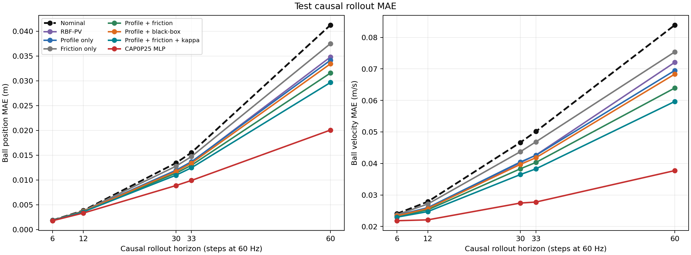
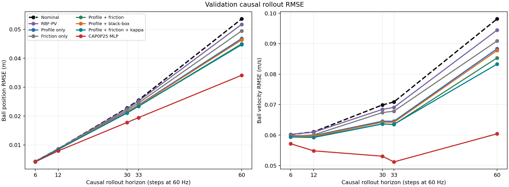
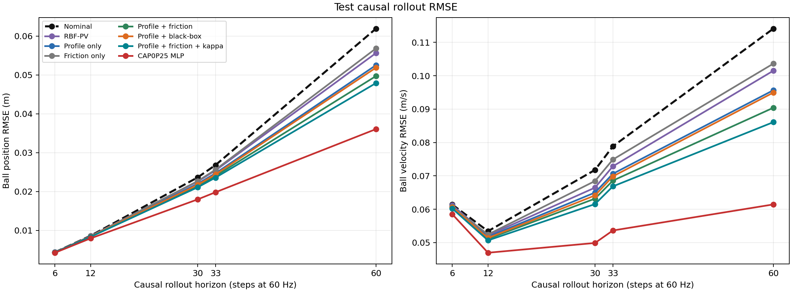
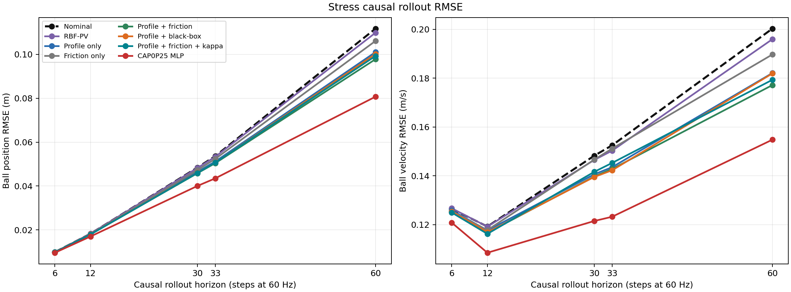
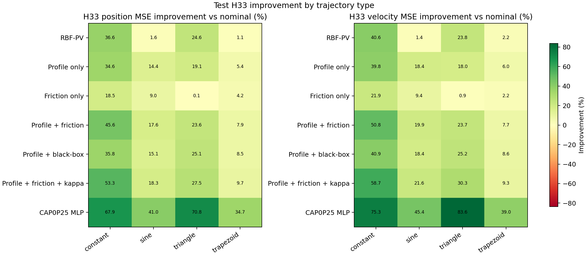
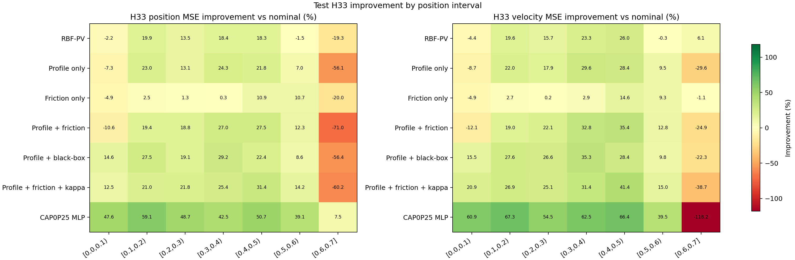
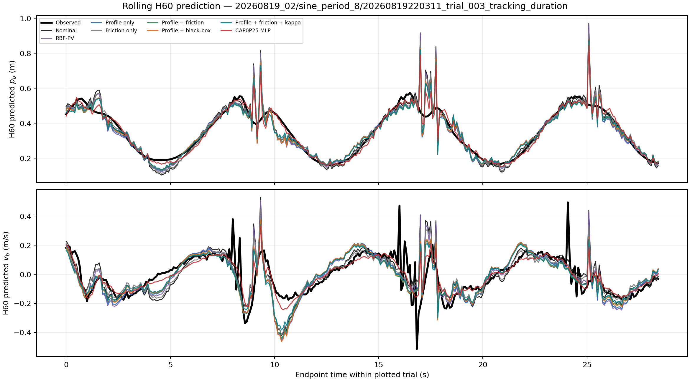
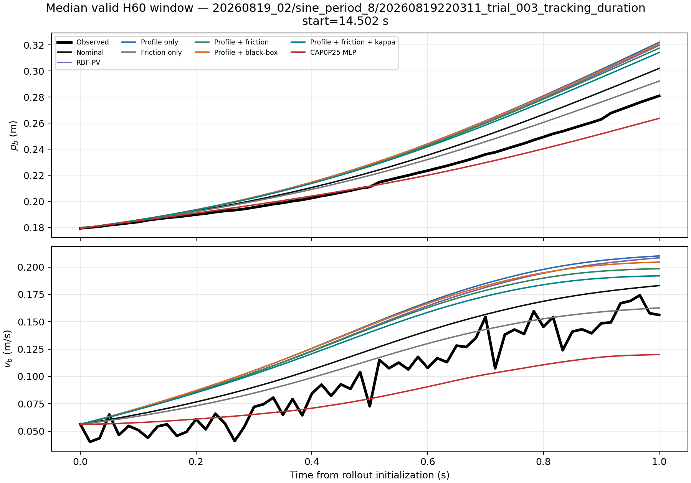
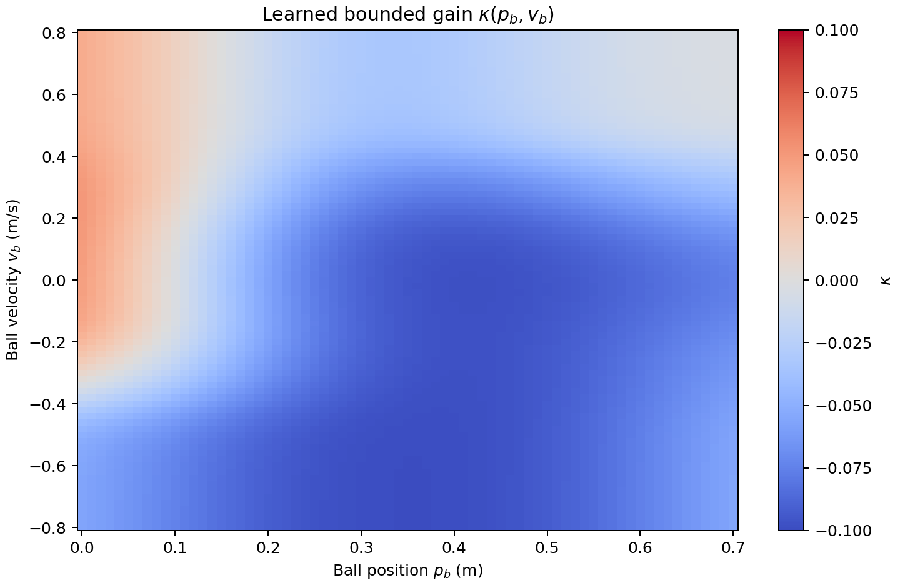

# Local-profile + structured/black-box/bounded-gain residual coarse probe

This diagnostic uses the immutable `residual_dynamics_v2` success-only train,
validation, test, and failure-prefix stress splits. Test and stress do not participate
in fitting or checkpoint selection. The implementation and complete JSON output are:

- `residual_dynamics_v2/profile_friction_probe.py`
- `residual_dynamics_v2/profile_friction_kappa_probe.py`
- `residual_dynamics_v2/results_profile_friction_probe/summary.json`
- `residual_dynamics_v2/results_profile_friction_probe/profile_friction_kappa_candidate.json`
- `residual_dynamics_v2/results_profile_friction_probe/profile_friction_kappa_candidate.pt`

It is an offline structural ablation, not an exported or deployable residual model.

## Candidate structure

The local-profile term changes only the gravity projection:

\[
r_{profile}=-\gamma g[\sin(\theta+\delta\theta(p_b))-\sin\theta].
\]

The structured friction term is constrained to oppose velocity:

\[
r_{friction}=-f_c(p_b)\tanh(v_b/0.025)-f_v(p_b)v_b,
\qquad f_c,f_v\geq0.
\]

The additional black-box comparison is

\[
r_{blackbox}=b_{RBF}(p_b,v_b),
\]

using the same normalized 9×9 Gaussian center grid and 0.10/0.10 m/(m/s)
widths as RBF-PV. It deliberately has no friction sign constraint, but still cannot
depend directly on `theta`, `omega`, or `a_nom`.

The bounded-gain comparison is

\[
r=r_{profile}+r_{friction}+\kappa_{RBF}(p_b,v_b)a_{nom},
\qquad |\kappa|\leq0.10.
\]

It uses the same normalized 9×9 Gaussian grid as the black-box term. Projecting all
81 coefficients to `[-0.10,0.10]` globally bounds the RBF-interpolated gain. This
candidate was trained incrementally with the same seed, data, loss, and validation
selection rule; none of the previously reported candidates was retrained. The
unchanged result blocks are protected by a recorded SHA-256 comparison.

All three one-dimensional functions use 13 normalized Gaussian bases with a 0.065 m
width. The profile correction is limited to ±0.035 rad, Coulomb magnitude to
0.15 m/s², viscous magnitude to 0.50 s⁻¹, and the sum is smoothly limited to
±0.25 m/s².

Black-box coefficients are projected to ±0.25 m/s². In `profile + blackbox`, the
profile and black-box sum shares the same final ±0.25 m/s² smooth limit. The
profile + friction + κ sum uses that same final limit.

Training uses seed 7. Stage 1 fits H=3/6/12 integral consistency plus point Huber
loss. Stage 2 adds causal rollout with H=6/12/30/33 weights
0.35/0.30/0.20/0.15. Validation selection assigns 65% of its score to h33 position
and velocity ratios. Therefore this probe tests dynamics prediction, not point RMSE
alone. The incremental κ run completed 52 stage-1 and 50 stage-2 epochs; stage-2
epoch 37 produced the selected validation score `0.9228395`.

## Results

### Point residual RMSE (m/s²)

| Model | Validation | Test | Stress |
| --- | ---: | ---: | ---: |
| Nominal | 0.135121 | 0.213534 | 0.425269 |
| RBF-PV | 0.130663 | 0.205562 | 0.420198 |
| Profile only | **0.126755** | **0.203176** | **0.410337** |
| Friction only | 0.138873 | 0.215671 | 0.434488 |
| Profile + friction | 0.130169 | 0.205187 | 0.415998 |
| Profile + black-box | 0.127232 | 0.202984 | **0.407555** |
| Profile + friction + κ | 0.128642 | **0.201453** | 0.415048 |
| CAP0P25 MLP | 0.128538 | 0.194653 | 0.430855 |

The profile term explains a reproducible position-dependent part of acceleration.
Friction alone makes point fitting worse. Adding friction to the profile sacrifices
some point accuracy but remains slightly better than RBF-PV on all three splits.
The black-box term retains almost all profile-only point accuracy and gives the best
new-candidate point result on stress. The bounded-gain candidate is the strongest
physical candidate on test point RMSE, but not on validation or stress.

### H12 acceleration-equivalent integral RMSE (m/s²)

| Model | Validation | Test | Stress |
| --- | ---: | ---: | ---: |
| Nominal | 0.173389 | 0.212896 | 0.425377 |
| RBF-PV | 0.169794 | 0.204556 | 0.422283 |
| Profile only | **0.165896** | **0.203274** | **0.417565** |
| Friction only | 0.175996 | 0.214388 | 0.432309 |
| Profile + friction | 0.168426 | 0.204516 | 0.421278 |
| Profile + black-box | 0.166353 | 0.202790 | **0.415749** |
| Profile + friction + κ | 0.168767 | **0.201747** | 0.420766 |
| CAP0P25 MLP | 0.161599 | 0.193382 | 0.413166 |

Profile-only is strongest on validation point/integral identification, the κ model
is strongest among the physical candidates on test, and profile + black-box remains
strongest on stress.

### H33 causal rollout RMSE

| Model | Validation pb/vb | Test pb/vb | Stress pb/vb |
| --- | ---: | ---: | ---: |
| Nominal | 0.025524 / 0.070874 | 0.026808 / 0.078845 | 0.053597 / 0.152481 |
| RBF-PV | 0.025156 / 0.069085 | 0.025431 / 0.072863 | 0.053300 / 0.150277 |
| Profile only | 0.023807 / 0.064548 | 0.024705 / 0.070625 | 0.051143 / 0.143533 |
| Friction only | 0.024507 / 0.067854 | 0.025626 / 0.074890 | 0.052329 / 0.151142 |
| Profile + friction | **0.023364 / 0.063484** | 0.024019 / 0.068582 | **0.050377 / 0.142795** |
| Profile + black-box | 0.023651 / 0.064206 | 0.024405 / 0.069854 | 0.050621 / **0.142255** |
| Profile + friction + κ | 0.023369 / 0.063540 | **0.023591 / 0.066848** | 0.050624 / 0.145268 |
| CAP0P25 MLP | 0.019450 / 0.051220 | 0.019827 / 0.053633 | 0.043471 / 0.123219 |

Profile + friction gives nominal-relative h33 MSE improvements of:

| Split | pb | vb |
| --- | ---: | ---: |
| Validation | 16.2% | 19.8% |
| Test | 19.7% | 24.3% |
| Stress | 11.7% | 12.3% |

The corresponding RBF-PV improvements are only 2.9%/5.0%, 10.0%/14.6%, and
1.1%/2.9%. Thus the structured terms provide a consistent rollout improvement on all
three splits, although they still do not reproduce the unconstrained five-input MLP's
offline rollout gain.

Profile + black-box gives h33 MSE improvements of 14.1%/17.9% on validation,
17.1%/21.5% on test, and 10.8%/13.0% on stress. It consistently outperforms
profile-only, but profile + friction remains better on validation/test h33 and stress
position. The stress velocity difference favors black-box by only about 0.00054 m/s.

Adding κ leaves validation H33 essentially unchanged relative to profile + friction,
improves test H33 MSE from 19.7%/24.3% to 22.6%/28.1%, but reduces stress improvement
from 11.7%/12.3% to 10.8%/9.2%. Its validation selection score is `0.92284`, only
slightly better than profile + friction at `0.92368`; the stronger test result is
therefore not accompanied by uniformly better generalization.

## Detailed causal-rollout comparison

The frozen models were reloaded without an optimizer and evaluated on exactly the
same selected windows as the original probe. The reconstructed physical candidates
reproduce every original rollout RMSE with a maximum absolute discrepancy of
`5.55e-17`; no retraining or checkpoint reselection was performed. Machine-readable
RMSE, MAE, counts, and nominal-relative improvements for every split, horizon,
session, group, trajectory type, and position interval are stored in
`results_profile_friction_probe/detailed_rollout_metrics.json`.

### Rollout MAE

H33 MAE gives a less outlier-sensitive view than RMSE:

| Model | Validation pb/vb MAE | Test pb/vb MAE | Stress pb/vb MAE |
| --- | ---: | ---: | ---: |
| Nominal | 0.013081 / 0.040834 | 0.015533 / 0.050138 | 0.034170 / 0.103216 |
| RBF-PV | 0.012686 / 0.038625 | 0.013600 / 0.042639 | 0.034072 / 0.100390 |
| Profile only | 0.012523 / 0.037738 | 0.013693 / 0.042584 | 0.034451 / 0.099782 |
| Friction only | 0.012544 / 0.038344 | 0.014728 / 0.046854 | 0.033761 / 0.102967 |
| Profile + friction | 0.012096 / 0.036075 | 0.012970 / 0.040309 | **0.033520 / 0.097459** |
| Profile + black-box | 0.012327 / 0.036983 | 0.013397 / 0.041809 | 0.033843 / 0.097925 |
| Profile + friction + κ | **0.012074 / 0.035832** | **0.012466 / 0.038282** | 0.033871 / 0.099258 |
| CAP0P25 MLP | 0.009721 / 0.027854 | 0.009909 / 0.027751 | 0.027372 / 0.081685 |

The MAE ranking agrees with the aggregate RMSE conclusion. Among the new physical
candidates, the κ model is best on validation/test MAE, while profile + friction is
better on stress. On stress pb, the
profile-only RMSE improves despite its MAE becoming 0.82% worse than nominal. This
means its apparent RMSE gain is concentrated in a smaller number of large errors and
is not a uniform sample-wise improvement.

The full MAE-versus-horizon plots are:

- `figures/rollout_mae_vs_horizon_validation.png`
- `figures/rollout_mae_vs_horizon_test.png`
- `figures/rollout_mae_vs_horizon_stress.png`

### RMSE as rollout horizon increases

The following figures show every model at H=6/12/30/33/60. The candidate differences
are small at H6 and become progressively clearer at H30–H60. On test H60, nominal
pb/vb RMSE is `0.06191/0.11413`; profile + friction reduces it to
`0.04971/0.09042`, profile + black-box to `0.05187/0.09496`, and CAP0P25 MLP to
`0.03607/0.06144`. The κ candidate reaches `0.04790/0.08610`, corresponding to
40.1%/43.1% MSE improvement over nominal and exceeding profile + friction on test.

### Improvement by trajectory type

The table reports test H33 pb/vb MSE improvement relative to nominal. Positive means
improvement; negative means degradation. Window counts are constant=1026, sine=342,
triangle=342, and trapezoid=318.

| Model | Constant | Sine | Triangle | Trapezoid |
| --- | ---: | ---: | ---: | ---: |
| RBF-PV | 36.6% / 40.6% | 1.6% / 1.4% | 24.6% / 23.8% | 1.1% / 2.2% |
| Profile only | 34.6% / 39.8% | 14.4% / 18.4% | 19.1% / 18.0% | 5.4% / 6.0% |
| Friction only | 18.5% / 21.9% | 9.0% / 9.4% | 0.1% / 0.9% | 4.2% / 2.2% |
| Profile + friction | 45.6% / 50.8% | 17.6% / 19.9% | 23.6% / 23.7% | 7.9% / 7.7% |
| Profile + black-box | 35.8% / 40.9% | 15.1% / 18.4% | 25.1% / 25.2% | 8.5% / 8.6% |
| Profile + friction + κ | 53.3% / 58.7% | 18.3% / 21.6% | 27.5% / 30.3% | 9.7% / 9.3% |
| CAP0P25 MLP | 67.9% / 75.3% | 41.0% / 45.4% | 70.8% / 83.6% | 34.7% / 39.0% |

This decomposition clarifies why the original profile + friction model performed
well overall: its largest advantage was on constant trials, which account for half
of the test windows. The κ model extends that advantage and is now the strongest
physical candidate on the aggregate test split. The black-box term is competitive on
triangle and trapezoid but remains weaker on constant trials.

The κ term improves all four test trajectory types relative to profile + friction,
with its largest gain again occurring on constant trials. However, validation
constant trials degrade by 1.2%/1.6% while validation dynamic trials improve. This
session-dependent reversal is another reason not to infer deployment readiness from
the test aggregate alone.

The corresponding validation and stress figures are
`h33_mse_improvement_by_reference_type_validation.png` and
`h33_mse_improvement_by_reference_type_stress.png` in the same figure directory.

### Improvement by position interval

Each H33 window is assigned using its midpoint position. The annotated heatmap gives
the test MSE improvement of every model relative to nominal:

The central `[0.1,0.5)` range contains 1,842 of the 2,028 classified test windows and
shows broadly positive improvement. The apparent edge behavior is much less certain:
`[0.0,0.1)` contains only 4 windows and `[0.6,0.7]` only 8. Several models degrade in
the upper edge bin—including profile + friction at -71.0%/-24.9% pb/vb—so neither
the favorable global average nor the extreme boundary percentages should be treated
as evidence of reliable edge behavior. Validation and stress position plots are also
stored beside the test figure.

### Representative trial visualization

The representative trial is selected deterministically rather than by model error:
the first sine trial in the test split,
`20260819_02/sine_period_8/20260819220311_trial_003_tracking_duration`. The rolling
plot reinitializes each model from the measured state every 5 samples and compares its
H60 endpoint with the observation 60 steps later. It therefore visualizes repeated
one-second causal predictions rather than an unconstrained full-trial free run.

The second figure shows the complete predicted and observed trajectory inside the
median valid H60 window, starting at 14.502 s. It makes the within-window accumulation
of position and velocity error directly visible.

## Learned physical magnitudes

### Bounded nominal-gain correction

The learned κ surface is predominantly negative rather than a small zero-centered
local correction:

- 33.3% of the 81 coefficients reach exactly ±0.10: 23 are at `-0.10` and 4 at
  `+0.10`. The observed experimental states predominantly interpolate the negative
  saturated region.
- On the outer `(p_b,v_b)` grid, κ spans `[-0.0993,+0.0505]`, with 14.5% of grid
  points satisfying `|κ|>=0.095`.
- On observed validation/test/stress samples, mean κ is
  `-0.0742/-0.0863/-0.0715`; 27.7%/50.1%/12.6% of samples are near the negative
  `-0.10` limit.

Thus the test improvement largely comes from learning an approximately 9%–10%
state-dependent reduction of nominal acceleration authority. This suggests a useful
physical hypothesis—nominal acceleration gain may be too large—but also shows that
the result is cap-limited. A constant calibrated-gain baseline should be compared
before attributing the benefit to a genuinely nonlinear κ surface.

End-to-end differentiation through the nominal acceleration gives total theta-gain
ratios of `[0.901,1.012]` on test and `[0.901,1.023]` on stress, with no observed
sample outside `[0.9,1.1]`. The intended direct gain bound is therefore respected on
these logs. The residual velocity-gradient P99 is `0.023 s^-1` on test but rises to
`0.146 s^-1` on stress; 1.59% of stress samples exceed `0.1 s^-1`, with a maximum of
`0.812 s^-1`. The κ model consequently avoids the five-input MLP's unconstrained
direct control channel, but it is not yet free of OOD anti-damping risk.

The profile-only curve is approximately -1.1° at 0.05 m, -0.52° at 0.15 m,
-0.18° at 0.25 m, +0.24° at 0.35 m, +0.23° at 0.45 m, +0.85° at 0.55 m,
and +1.61° at 0.65 m. One coefficient reaches the configured ±2.005° limit, so the
poorly covered boundaries remain uncertain.

In the combined model, Coulomb friction is about 0.015–0.022 m/s² through the central
beam and rises toward 0.058 m/s² near 0.65 m. Viscous friction is almost zero below
0.35 m, then rises to about 0.065 s⁻¹ at the high-position edge. These signs are
physically dissipative, but the edge growth may partly reflect sparse data or response
model error.

The black-box coefficient absolute maximum is 0.124 m/s²; no coefficient approaches
the ±0.25 projection. Its outer-grid output spans approximately -0.103 to
+0.114 m/s². It is not close to an odd friction law: the coefficient-grid
anti-symmetry error RMS (0.0556) is comparable to the coefficient RMS itself (0.0546).

Unlike structured friction, this flexibility creates unsafe velocity derivatives.
For the black-box term alone on `pb∈[0,0.7]`, `vb∈[-0.8,0.8]`:

| Derivative | Min | P1 | P99 | Max |
| --- | ---: | ---: | ---: | ---: |
| `r_p` (s⁻²) | -0.610 | -0.598 | 0.546 | 0.561 |
| `r_v` (s⁻¹) | -0.379 | -0.327 | 0.444 | 0.505 |

About 23.2% of the grid has `r_v>0.1 s⁻¹`. The final tanh limiter reduces these
values in saturated regions but does not provide an anti-damping guarantee.

## Interpretation

The experiment supports four separate conclusions:

1. A static local-angle profile is substantially better supported than friction alone;
   it improves point, integral, and rollout metrics across all held-out splits.
2. Dissipative friction is not supported by point or integral error alone, but it adds
   consistent h33 rollout improvement when combined with the profile. It may represent
   true friction, useful damping, or a response-chain mismatch, so its causal meaning is
   not yet established.
3. Black-box compensation is a better point/integral compromise than friction and adds
   rollout benefit, but its validation selection score (0.9260) remains worse than
   profile + friction (0.9237), and it reintroduces substantial anti-damping gradients.
4. The bounded κ candidate improves test H33/H60 beyond profile + friction while
   retaining the observed theta-gain ratio inside `[0.9,1.1]`. Its validation gain is
   negligible, stress velocity prediction is worse, one third of coefficients saturate,
   and stress contains a positive velocity-gradient tail. It is promising as a bounded
   gain-calibration hypothesis, not yet as a deployment-ready nonlinear correction.

The next formal model should therefore retain profile + structured friction as the
safety baseline and compare the learned κ surface with a constant `κ=-0.05/-0.10`
gain-calibration ablation. Only if the state-dependent κ gives repeatable cross-session
benefit should it enter NMPC, with explicit `r_v` constraints and OOD attenuation.
Profile + black-box remains useful as an upper-bound ablation, but it should not be
considered deployable without explicit `r_p/r_v` losses, outer-grid derivative gates,
OOD attenuation, and full control-sensitivity validation. All candidates still need
per-session/group/direction reports, boundary uncertainty, direct theta-gain checks,
and independent physical beam-profile measurement.
